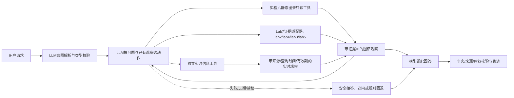

# 实验七剩余局限补全计划

> 本文是后续实施计划，不代表其中工作已经完成。按用户决定，实验六保持不变。

## 1. 依据、起点与阶段边界

本计划依据仓库主说明 [README.md](../README.md) 的实验衔接约定、前序 [实验六报告](../实验六报告.md) 的 471 节点/629 边图谱与来源边界，以及 [实验七报告](../实验七报告.md) 7.10 节列出的六项局限。README 将实验七定位为复用实验六图谱的旅游规划 Agent；实验六报告明确图谱表达既有材料，不核验当前开放、票价与实际通行情况。因此，本阶段沿用“实验六提供可追溯静态事实、实验七负责查询和回答”的方向。

**用户已确定实验六不改。** 不修改 `src/lab6/`、`data/lab6/`、`outputs/lab6/` 或《实验六报告.md》。需要扩展的实验七证据、路线补充集、实时查询结果和缓存均放在标准 `src/lab7/`、`data/lab7/`、`outputs/lab7/` 对应位置，并标注来源、抓取/查询时间和有效期限；不把实时值写回实验六图谱。

当前起点：动态工具决策及参数提示已经实现；项目环境中的离线场景 8/8、自动验收 47/47 通过。最新一轮完整在线运行（配置 `deepseek-v4-pro-0813`、单请求超时 60 秒）完成 8 例但 **0/8 通过**：35 次请求中 23 次有响应，15 次工具决策中 2 次被接受，发生 20 次回退，既有网络超时/断连，也有工具参数不符合当前动作契约、提前停止等问题。随后修正了意图 JSON 类型校验，并加强动作参数提示和安全归一化；修复后离线回归仍为 8/8、47/47。按用户要求，包含这些修正的下一轮在线测试已中止，不能算完整在线结果。该差异必须在后续验收中保留，不能覆盖或重写旧记录。

## 2. 总目标、任务书映射与非目标

目标是针对报告 7.10 的六项局限逐步形成可复查、范围明确的实验七能力：真实 LLM 闭环有成功轨迹；多场景测试覆盖更多输入边界；示范结果能够重放；回答证据可追到实验二至实验五；路线和游客适配所需的数据缺口被明确处理；实时信息通过单独的数据工具按时效查询。每项只在相应的自动和/或真实验收完成后才标记解决。

| 报告局限 | 本计划交付 | 边界/验收含义 |
|---|---|---|
| 1. 动态决策版真实在线验收未通过 | 修正后完整在线套件及至少一条真实闭环轨迹 | API 失败、模型回退或错误决策均不计真实 LLM 通过 |
| 2. 仅覆盖 8 类输入 | 分层扩充场景目录和断言 | 覆盖范围扩大不等于任意输入都可靠 |
| 3. 缺少本版本真实示范 | 保存脱敏的成功链路摘要和可复核运行 ID | 不以旧版 8/8 结果替代新链路 |
| 4. 证据仅有 lab3/lab5 | Lab7 只读适配实验二实体和实验四审核共指证据 | 每条新证据保留来源和位置；缺少原文时照实标记 |
| 5. 景区/路线/体力数据不足 | 评估并补充 Lab7 版路线与属性资料，或明确未覆盖项 | 不改实验六图谱；未经可靠来源核验的数据不能用于适配结论 |
| 6. 不提供实时状态 | 独立的 Lab7 实时信息工具、缓存时效与失败说明 | 静态图谱与实时响应分开；数据源、时效和成本需先核实 |

非目标：不改写实验六结论、不把历史建议当作当日指引、不自动编造路线或体力适配、不承诺覆盖全部中国景区、不把在线模型响应等同于事实正确。未获用户明确选择前，不接入收费数据服务、不提交真实个人出行信息、不产生 API 之外的外部订阅费用。

## 3. 用户场景与入口

保留现有 CLI `src/lab7/cli.py` 和显式在线入口 `run.ps1 -Lab 7 -Online`。扩充以下用户流程：

1. **真实闭环复核**：“带老人去黄山一天，帮我安排轻松些”→模型解析与决定查询路线/建议→图谱 Observation→模型根据观察决定后续动作→最终回答引用返回地点和证据。
2. **多轮与歧义**：用户未给景区时先追问或按已声明规则选择；用户补充/更改天数时不沿用过期约束；景区名错写或未收录时澄清，不借用别处路线。
3. **来源问答**：“迎客松被提及多少次、依据哪些文本？”→实体统计及证据来源→逐项展示文档 ID/位置/审核状态，不把计数描述成可信概率。
4. **路线适配**：“老人是否能完成这条路线？”→只在有可核验距离、坡度、海拔、交通和时间数据时给有界结论；否则指出具体缺失项。
5. **实时状态**：“明天索道开放吗/门票多少？”→调用独立实时工具→展示来源、查询时间、有效期；无数据或过期时说明无法确认，不用历史建议填补。

## 4. 目标架构与数据流

图谱仍是路线和实体等相对稳定事实的来源；证据适配器只读既有实验结果；实时工具获取时效短的信息，不写图谱。模型只提出动作和组织语言，Agent 对动作白名单、参数、用户约束、来源、时效和调用预算负责。实时源不可用时，工具必须返回“未知/过期/请求失败”状态，不得伪装为空间事实或调用历史建议替代。

## 5. 接口、状态与失败契约

| 数据/接口 | 输入 | 输出 | 权限与错误处理 |
|---|---|---|---|
| LLM 决策 | 原问题、校验后意图、动作专属 Schema、已读 Observation、动作历史 | `action/args/reason` | 只允许注册动作；JSON/类型错误、越权和超时均记录阶段并有界回退；回退计为在线用例失败 |
| Lab7 图谱工具 | `scenics/route/advice/entity` 的白名单参数 | 图谱事实、`evidence_refs`、`found` | 只读实验七现有图谱副本；不得写回实验六；空结果和工具错误用显式状态返回 |
| Lab7 证据适配器 | 实验二实体 ID/位置、实验四审核记录和现有证据键 | 标准证据对象：来源实验、文件、记录 ID、位置、原文片段/审核状态 | 只读；定位不一致、缺文件或审核状态不明时不采纳并记录原因；不得仅凭相似字符串合并 |
| Lab7 路线补充数据 | 官方或可靠来源的路线、距离/海拔/坡度/时长等字段 | 版本化补充路线记录及来源/采集时间/审核状态 | 存于 `data/lab7/`；无可靠来源的字段保持未知；禁止推断老人/儿童安全结论 |
| 实时工具 | 景区、字段类别、查询日期或时段 | `value/status/source/checked_at/valid_until` | 每来源单独适配；超时、限流、无数据、过期、冲突均显式返回；密钥只从环境配置读取且不得入日志 |
| 最终回答校验 | 用户约束、工具结果、证据与有效期 | 可展示回答、引用/时间标注或拒答/澄清 | 禁止无来源实时断言；任何必需数据缺失时降低结论强度；工具调用有总次数和超时上限 |

重复请求采用缓存键（景区+数据类型+查询日期/时段），缓存超过该数据源有效期即视为过期而非有效结果；用户取消时停止后续动作并保留已完成阶段日志。在线测试不自动重试，不因规则回退而判为通过。

## 6. 工作包与依赖顺序

| 工作包 | 目的与场景 | 前置条件、文件及实施步骤 | 输入/输出、失败/重复/取消行为 | 验收与完成定义 |
|---|---|---|---|---|
| A. 动态 LLM 稳定性闭环 | 修复局限 1、3；验证真实解析、动作、观察、回答 | 前置：当前可访问模型及在线权限；检查 `llm.py`、`agent.py`、`prompts.json`、`online_tests.py` 和当前实测诊断；为意图字段、每类 action 参数、提前 stop、超时和断连建立定向断言；不改密钥 | 保留一次请求一次结果；模型输出异常时做安全归一化或规则回退并记录；超时按运行参数停止当前调用，不自动重试；取消运行保留“中止”标记 | 离线/模拟全部通过；真实在线 8/8 通过、无回退、所有决策被接受；至少 1 条真实轨迹显示工具 Observation 后模型再决策，且 Final 使用工具事实。否则仅标“部分完成” |
| B. 扩展测试集与交互边界 | 修复局限 2 | 前置 A 的请求诊断稳定；更新 `scenarios.json`、`test_catalog.json`、`online_tests.py`、`check.py`、`测试集说明.md`；新增多轮补充/更改、歧义/错别字、空结果、混合意图、模型格式错误等分层用例 | 离线 fixtures 有确定输入/输出；在线测试串行、无自动重试；同一用例重复跑结果分开存档；缺服务时标未执行/失败，不伪通过 | 每个新增场景有明确工具预期、必需约束、禁止行为和失败标准；离线所有断言通过；真实 LLM 每例按同一验收口径记录；报告说明模型与输入范围 |
| C. 前序证据回指 | 修复局限 4 | 前置：读核 lab2/lab4 现有产物和字段；只修改 Lab7 的 `graph_tool.py`/适配模块、`check.py`、fixtures 和目录登记；不得修改实验六文件 | 输入来源记录 ID、字符位置、审核值；输出标准证据对象和可读片段；源文件缺失、位置越界或预测与审核不一致时拒绝引用并说明 | 对代表性实体核对计数与来源位置；实验二统计、实验四已审核共指分别有专门断言；回答中的每条新证据可回指原产物；Lab6 路径哈希/工作区状态保持不变 |
| D. 路线覆盖与适配数据评估 | 修复局限 5 | 前置：列出课程材料/公开官方来源可支持的景区和属性；不改 Lab6 的图、规则、报告；只将经审阅补充项放入 Lab7 版本化数据目录，来源和人工核验责任可追踪 | 输入候选路线和属性、来源 URL/标题、采集日期；输出来源登记、对齐实体、缺字段清单；冲突或不可验证字段隔离；不得按景区名猜步行距离或安全等级 | 先验收来源和字段质量，再开放 Agent 查询；路线步骤、顺序可回指其来源；距离/坡度/时间为空时系统明确拒绝体力保证；新增景区只有通过来源、路线顺序和覆盖断言后才可参与选择。资料不足时此工作包以“缺口清单完成”结束，不虚报数据扩充 |
| E. 实时信息独立工具 | 修复局限 6 | 前置：先确认可用且不产生未授权费用的数据源；若只有收费/凭证源，停在接口设计和模拟，不接入生产；新增 Lab7 `live_info` 工具、来源配置/时效策略、错误模拟和测试目录项；扩展决策动作但不写回图谱 | 输入景区、数据类别、日期；输出值、来源、检查时间、有效期和状态；超时/空值/来源冲突均返回未知；同键缓存只在有效期内复用；取消停止其余请求 | 模拟覆盖有效、过期、无数据、断连、冲突与缓存；真实源只在获批且有访问权限时验收；回答每个动态断言都显示来源和时间；过期数据绝不作为当前事实；对静态路线查询不触发实时请求 |
| F. 唯一报告和交付回归 | 让结果能复现且不混淆历史 | 依赖 A–E 结果；只更新本计划、`实验七报告.md`、`测试集说明.md`、`运行说明.md`；原始运行日志保留，不新增重复报告 | 报告分别标明代码、模拟、真实在线和人工核验边界；失败结果不可覆盖；交付前核对报告中的哈希、计数和运行文件 | 所有已做工作有入口、输入输出、复现步骤、证据链接、局限与下一阶段边界；实验六文件内容不变；没有进行的工作明确标未执行 |

依赖关系：`A → B`；`C` 可与 `B` 并行但要在最终回答引用验收前完成；`D` 的来源/数据质量审核通过后才能供 Agent 使用；`E` 必须先选定非收费或已获用户授权的数据源，之后才进入真实接入；最后 `F` 汇总所有实际验收。不得为了赶进度把未经审核的 C/D/E 数据喂给模型。

## 7. 总体验收与完成边界

1. **回归**：项目专用环境 `D:\miniconda3\envs\dm_scenic_lab` 运行离线场景和自动验收；覆盖用户硬约束、动作参数、证据来源、实时过期状态和异常回退。
2. **真实模型**：完整在线集必须有实际成功响应；任何用例的 LLM 阶段回退、非法动作或规划校验失败均使该用例失败。一次真实成功闭环必须显示至少“模型决策→图谱调用→Observation→模型后续决策/最终回答”的真实轨迹。
3. **证据完整性**：lab2/lab4 新引用可以从回答回到来源文件和记录位置；新增 Lab7 路线补充项有来源和核验时间；实时值有来源、查询时间及有效期。
4. **实验六不变**：前后对比 `src/lab6/`、`data/lab6/`、`outputs/lab6/` 和《实验六报告.md》无改动；实验七读取既有数据仍可复现。
5. **真实边界**：没有公开可靠来源的数据仍标“未覆盖”；不以 8 个或扩充后的固定用例推断任意用户请求都正确；旅游安全、实际通行和官方运营责任不由模型推断替代。

本计划完成只表示范围、工作包和通过标准已确定，不表示局限已修复。收费服务、扩大项目目标或改变实验六的决定均不在本次授权内；若后续数据源要求其中任何一项，先提交具体影响与替代方案再继续。
