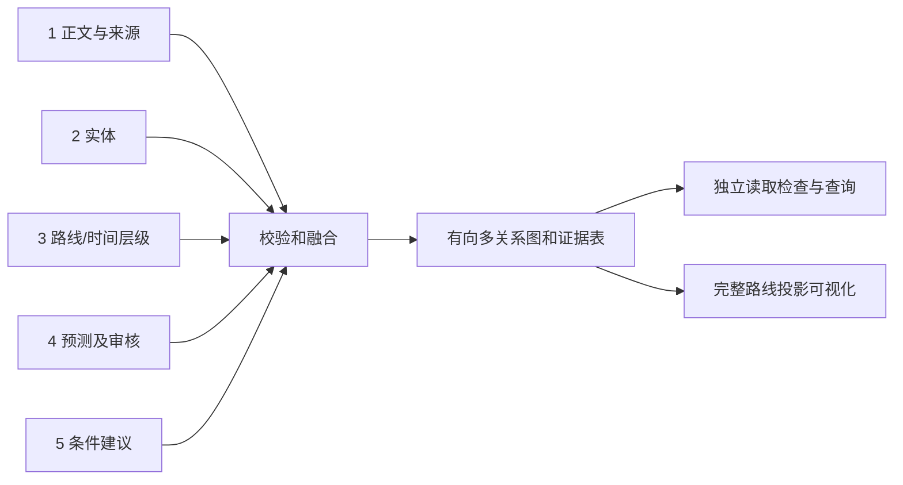

# 实验六执行计划

## 1 起点与主线
任务书《景区游览指南的程序性知识挖掘》为课程总体计划的权威来源：实验1准备文本→2实体→3路线→4指代→5条件→6融合图谱→7查询应用。已读取任务书实验六正文/评分表、前五次报告和实际成果、最近目录整理验收报告。当前实验三以6d4750c的黄山/九寨沟/张家界为准，与实验二景区一致。旧实验三与六按用户明确授权删除，保留新版原始快照及本次证据。

## 2 目标及边界
将实验2实体与实验3三条路线真正关联；使用实验1正文校验来源/位置，实验4仅作为审核通过的指代证据，实验5有筛选地融入。构建NetworkX有向多关系图，导出JSON/CSV/GraphML；完成完整景区可视化、查询与质量检查。只使用现有数据，默认离线；不改旧实验数据、不生成Word、不实现实验七Agent、不声称当前旅游信息有效。

## 3 场景与架构
命令行 run.ps1 -Lab 6 → 输入校验 → 景区/类型/审定名称对齐 → 路线步骤、条件和来源关联 → 图结构持久化 → 查询、图示、验收。节点身份和路线中的重复出现分开表达，防止回到入口成为假自环或重复删除。

## 4 工作包及依赖
| 包/依赖 | 场景、实现文件和步骤 | 契约与完成标准 |
|---|---|---|
| WP1/无 | build.py校验实验1 CSV正文哈希、原始记录与实验2全部位置；记录损坏JSONL并使用合法CSV，不猜测修补 | 缺文件/位置错立即失败；保存manifest与可复用正文快照，原输入不动 |
| WP2/WP1 | rules.json按景区/类型对齐，保留具体索道；lab3步骤定位到实体；父子区域不等同；交通设施不标为景点 | 同义例合并，反例分离；完整对齐和隔离审计；频次为独立位置数而非概率 |
| WP3/WP2 | build.py构图；coref审核一致且先行词实体可定位才附证据；条件排除未消歧/跨景区 | 所有节点边有证据；稳定ID，NEXT仅同路线相邻步骤；重复运行JSON相同 |
| WP4/WP3 | figures.py以九寨沟完整11步构图，展示地点、步骤、时间和交通及来源计数，条件另附 | 所有步骤可见，图例明确、字体可读，保存SVG/PNG并目视检查 |
| WP5/WP3、4 | check.py从导出独立读取；query.py给出路线、实体来源、条件查询 | 类型/端点/顺序/连通/来源校验，正例、反例、低频与无结果/污染输入测试通过 |
| WP6/WP5 | 唯一实验六报告.md严格6.1—6.6；更新README、run.ps1 | 实测数量、查询、图与代码一致；评分30/30/20/10/10各有证据，不自评满分 |

## 5 接口、恢复与执行规则
节点类型Scenic/Place/Transport/Time/Route/Step/Condition/Advice；关系HAS_ENTITY、HAS_ROUTE、HAS_STEP、AT、NEXT、DURING、USES、HAS_CONDITION、RECOMMENDS、MENTIONS。标识按类型/景区/规范名散列，步骤按路线/序号。来源独立表关联文件、记录、字符位置和来源类别。名称相同但类型或景区不同不合并。低频有上下文即保留；歧义诺日朗隔离。上游时间不一致并列记录，不伪造精确时间。

输出在outputs/lab6，原始输入只读。中断后重跑；不并发运行，无跨文件事务保证，check失败则不算交付。失败与修复记录留在evidence，不放宽验收。范围内可逆修复自主完成；改变总体目标或收费另需用户决定。

## 6 验收与交付
正常：三条新版路线全部进入图、三景区有实体关联、全部合法条件及指代证据有审计；JSON/GraphML可重读；三景区各自连通、不强造跨景区边。边界：循环回入口仍保留两个步骤、百龙天梯为交通、同名父子不并、低频白鹅山庄保留、示例游客来源不冒充真实记录。失败：错实体位置、悬空边、跨路线NEXT须被拒绝。交付唯一报告、代码、结构输出、完整景区图、实际查询与检查证据，为实验七提供只读图谱查询入口及局限；不把历史图谱等同于可执行行程。

## 关系语义修复工作包
修复依据为实验六报告评分复核补记。先收紧USES为设施自身或原文单个操作分句内的明确乘坐，不再整段关键词分发；同起终点USES合并证据。新增SOURCE_TIME、SOURCE_TRANSPORT作为实验一另一官方路线的来源上下文（不是实验三同一路线的时间表），仅对原文箭头行精确端点、实验二实体位置、且实验三唯一出现地点关联。重复地点不猜测出现次序；跨路线原文上下文不得转成DURING或USES。补充固定语义反例与全量来源片段检查，重绘图，保留旧检查输出并更新唯一报告。完成标准：张家界1/2步不连百龙；第3步仅一条USES；九寨沟有可追溯上下文时间/交通关系；无混淆两条路线；完整入口和新检查通过。
