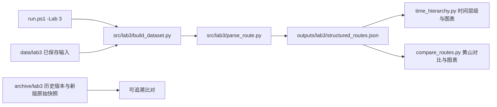

# 项目目录整理实施与验收报告

## 1 当前结果与版本依据

2026-11-05按用户确认，将远端提交 **6d4750c** 中的 `实验三/` 作为最新权威版本，迁入统一目录。当前实验三为**黄山、九寨沟、张家界**版本，替换此前故宫、颐和园、西湖的活动版本。实验一、二、四、五仍沿用原有路径与代码，原有未提交修改保留。本次没有提交或推送Git。

依据为当前项目README的按实验编号组织约定、用户本次版本确认及 [唯一执行计划](目录整理执行计划.md)。此前不存在独立项目总计划；整理前已阅读上一版整理验收记录。前次报告保存为机器证据中的 `previous_acceptance_report.md`，旧迁移/运行证据没有删除。

| 内容 | 当前活动位置 | 历史位置 |
|---|---|---|
| 新版正式代码 | `src/lab3/` | 新版逐字节原始快照：`archive/lab3/versions/upstream_6d4750c/` |
| 新版输入 | `data/lab3/raw/`、`data/lab3/processed/` | 同上快照 |
| 新版结果与配图 | `outputs/lab3/`、`outputs/lab3/figures/` | 同上快照 |
| 新版Word、原说明、辅助脚本及日志 | 不参与正常运行 | `archive/lab3/latest_6d4750c/` |
| 替换前本地活动版本 | 不再作为输入 | `archive/lab3/versions/local_before_6d4750c/` |
| 旧版实验六中间图谱与证据 | 不再作为当前产物 | `archive/lab6/versions/pre_lab3_6d4750c/` |

根目录已没有独立 `实验三/` 文件夹。根目录任务书和实验一Word保留原位，未动用户文档。旧 `archive/lab3/` 中前次归档也保留，仅 `latest_6d4750c` 表示本次新版辅助材料。

## 2 结构与模块职责



统一入口顺序执行构建、解析、时间层级、对比。文件是模块间契约；退出终端后输入和输出仍保存，下次运行直接复用，不依赖聊天记忆。无新增Agent、模型、网络服务或费用。

| 核心模块 | 为什么存在、输入输出与关键逻辑 | 失败行为及验证 |
|---|---|---|
| [run.ps1](../run.ps1) | 统一选择实验并固定专用Conda环境；实验三依次调用四个正式脚本 | 子进程失败立即抛错；本次离线成功，不运行在线采集或Word生成 |
| [build_dataset.main](../src/lab3/build_dataset.py) | 已保存采集和语料＋上游整理路线→统一数据集；保留原来源说明 | 继承上游缺文件回退空列表行为；迁移输入哈希与重建结果核对通过 |
| [parse_route.main](../src/lab3/parse_route.py) | 三种文本格式→步骤/时间/景点/活动 | 缺少数据集或非法JSON会失败；算法语法树与远端版一致，输出与原版一致 |
| [time_hierarchy.main](../src/lab3/time_hierarchy.py) | 步骤→时段层级JSON及PNG | 上游缺失、依赖或写权限错误会失败；JSON等价，PNG可解码 |
| [compare_routes.main](../src/lab3/compare_routes.py) | 黄山官方步骤＋内置游客叙述→覆盖/顺序/时间分配 | 原指标算法保留；JSON等价，PNG可解码 |
| 采集脚本 | `scenic_crawler.py`、`load_industrycorpus.py` 保留新版实现，路径适配 | 会联网并覆盖输入；本阶段未运行联网采集，只核对算法未变及语法可解析 |
| 归档与版本标识 | 保存新版原始37文件、旧版活动目录、旧实验六图；`data/lab6/upstream_status.json` 标记需重建 | 不自动回滚；历史脚本只作证据，不能作为迁移后正式入口 |

本次仅适配脚本根路径、输入与输出路径及说明，**没有修改新版实验三算法**。通过比较抽象语法树（去掉根路径赋值和文档字符串后比较程序结构），六个正式/采集脚本逻辑与远端原文件一致。

关键路径适配以解析器为例：

```python
ROOT = os.path.dirname(os.path.dirname(os.path.dirname(os.path.abspath(__file__))))
PROC = os.path.join(ROOT, "data", "lab3", "processed")
OUT = os.path.join(ROOT, "outputs", "lab3")
```

代码从自身位置找到项目根，不依赖用户当前目录。输入结构和输出字段保持远端新版原样。

## 3 一个实际任务的完整运行

用户运行实验三：统一入口读取新版采集与语料→构建三景区样本→解析路线→构建上午/中午/下午层级→比较黄山官方与示例游客路线。

实际黄山输出：官方14步，游客示例9个去重景点；覆盖率66.7%，现有顺序指标88.9%；遗漏云谷寺、慈光阁、排云亭、散花坞。官方时段计数 `[5,4,5]`，示例 `[3,3,3]`。三份结果JSON与远端原版相同，说明目录调整没有改变本次样本的计算结果。

本次属于整理和兼容性验证，不新增真实游客采集，也不将脚本内置游客示例解释为独立实测。

## 4 本地启动、持久化与恢复（命令行）

```powershell
Set-Location D:\data_lab\scenic_lab1
powershell -NoProfile -ExecutionPolicy Bypass -File .\run.ps1 -Lab 3
```

使用 `D:\miniconda3\envs\dm_scenic_lab`，本阶段未新增依赖。读取 `data/lab3/`，覆盖派生结果到 `outputs/lab3/`。`-Lab all` 仍包含实验一至五；本次没有执行all，以免覆盖用户实验一的本地派生文件。

如执行中断，可重新运行上述命令；没有自动事务回滚和并发写入保证。新版原始快照完整保留，可按迁移清单定位每个文件的来源；旧活动版本独立保存，不能与当前输入混用。

## 5 验收与证据

证据目录：[outputs/maintenance/lab3_6d4750c](../outputs/maintenance/lab3_6d4750c/)。

| 验收项 | 实际结果 | 支持文件 |
|---|---|---|
| 新版迁移完整 | 37文件复制时逐个核对SHA-256（内容指纹），远端原始快照最终复查通过 | `migration_manifest.json`、`verification.json` |
| 活动输入与归档一致 | 新版数据及辅助材料与原快照字节一致；生成图表允许重绘 | `verification.json` |
| 专用环境离线入口 | 退出0，四个处理步骤完成 | `offline_run.log` |
| 结果不变 | structured_routes、time_hierarchy、route_compare三份JSON均与新版原结果等价 | `verification.json` |
| 算法不变 | 六份正式/采集脚本除路径与文档说明外程序结构相同 | `verification.json` |
| 原有工作保留 | cleaned_data.jsonl、实验一报告、实验六原型代码哈希未变 | `protected_files.json`、`verification.json` |
| 新旧版本分离 | 根独立目录移除；旧实验六graph不在活动outputs中 | `verification.json` |
| 图表有效 | 两张复跑PNG可解码 | `verification.json` |

共82项机器检查通过。验证由本次实施助手执行，无独立人员或独立模型审核；不以检查数量代替实验质量。无新增失败运行；前阶段失败记录保留在原证据/归档。

## 6 局限与下一阶段边界

- 最新实验三与实验二已覆盖相同景区，**此前实验六“景区交集为空”的分析已失效**。已在实验六唯一执行计划开头明确标注，旧补建路线方案不能直接继续。
- `src/lab6/` 代码保持为未完成原型，尚未适配本次新版；旧图谱全部归档，`run.ps1`未开放实验六入口。本阶段没有宣称完成实验六。后续需直接核对新版实验三、实验二及其他实验的关联，再重建与验收。
- 新版实验三的路线文本仍独立于实验一官方原文；同景区不等于同路线。内置游客示例、时间近似、SequenceMatcher指标等上游局限保留，详见根目录实验三报告。
- 联网采集、Word导出和其他实验全链路不在本次复跑范围；原JSONL的既有格式问题没有擅自修复。
