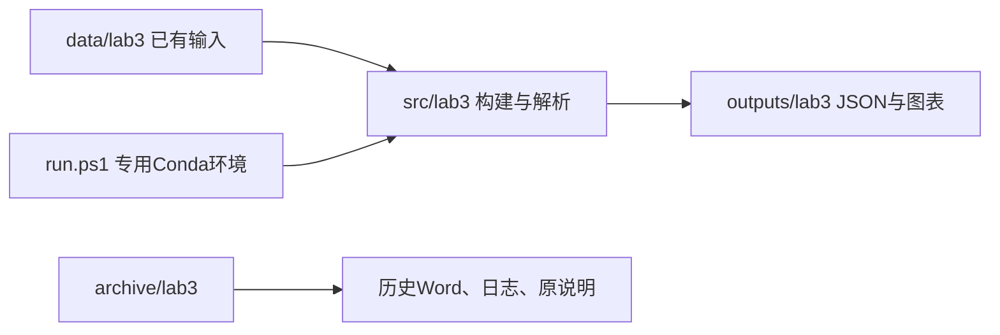

# 项目目录整理执行计划

## 起点、目标与边界
当前 main 为 17f8114，实验一、二、四、五按 src/labN 组织，实验三独立且 README 提及的 run.py 实际不存在。已阅读根 README、实验三 README 和前序实验五报告；仓库没有独立的项目总计划，本次以 README 的按实验编号组织约定及用户本次目录整理要求为依据，不扩展实验算法或新实验范围。

目标：统一代码、数据、结果、历史材料的归属；保留实验一稳定数据路径与全部已有本地工作。不会重新联网采集或生成 Word，不推送远端。

## 使用场景、架构与模块
主场景：用户从根目录运行 run.ps1 -Lab 3，读取已有实验三样本，得到与搬迁前等价的结构化 JSON 及图表。

| 工作包 / 依赖 | 实施内容 | 验收通过条件 |
|---|---|---|
| 1 清点与记录 / 无 | 记录原有修改、输入输出文件哈希；创建唯一计划与报告 | 未覆盖用户修改；不存在未经说明的总计划 |
| 2 搬迁 / 1 | 代码到 src/lab3；数据到 data/lab3；输出到 outputs/lab3；历史资料到 archive/lab3 | 搬迁前后文件字节一致；根目录不再存在独立实验三文件夹 |
| 3 路径与入口 / 2 | 更新项目根定位、输入输出路径；将实验三加入 run.ps1 及 all；修正旧环境配置；补齐实际依赖 | 从项目外调用入口仍正确定位；失败立即终止，不自动下载、不生成Word |
| 4 验证与交付 / 3 | 专用环境离线复跑实验三，核对 JSON 与原结果，更新 README 与唯一验收报告 | 结构结果等价、图表生成、其他实验路径不变，报告明确验证范围 |

## 契约、恢复与变更控制
- 输入使用已有 crawled_pages.json、industrycorpus_tourism_sample.json；保留来源字段，不改变实验三独立样本体系。
- 输出覆盖同名派生文件，重复运行应产生等价 JSON；不做并发写入保证。中断可重新运行；上游失败由统一入口立即抛错，已写文件不会自动回滚。
- 网络采集脚本保留为显式手动入口，不加入 all。历史 Word 生成脚本归档，不参与运行。
- 不改变实验结论；原算法的样本、时间近似及评价局限如实保留。新实验另行依据任务书规划。
- 验收含正常离线流程、重复执行、项目外启动、无效实验编号拒绝及迁移完整性检查；不会把整理验证称作算法独立验收。

## 交付
更新统一入口、依赖、README、AGENTS；交付 docs/目录整理实施验收报告.md。迁移清单及运行日志放 outputs/maintenance/，作为机器证据。保留历史证据，不新增重叠说明文档。

## 2026-11-05 版本更新整理

用户确认远端提交6d4750c的实验三为最新权威版本。以该版本替换活动src/lab3、data/lab3、outputs/lab3；旧活动目录和实验六旧输入派生产物完整迁入archive版本目录。原远端文件逐个哈希校验后归位，正式脚本仅适配路径，不改变算法；在线run.py及Word/截图生成脚本归档。验收：最新版三景区、迁移完整、离线入口成功、结果与远端原JSON等价、既有用户修改内容不变。沿用本计划与同名唯一验收报告，旧证据保留。
