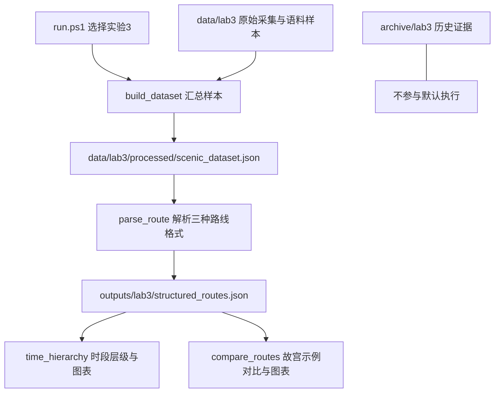

# 项目目录整理实施与验收报告

## 1. 完成了什么

本阶段将实验三纳入与其他实验一致的目录和启动方式：现在从根目录执行 `run.ps1 -Lab 3`，即可使用已保存输入完成数据汇总、路线解析、时间层级和路线对比。根目录不再有独立 `实验三/` 文件夹。

依据：[执行计划](目录整理执行计划.md)、项目 README 的按实验编号组织约定，以及用户本次整理要求。仓库没有独立项目总计划，未假称存在；已阅读前序实验五报告。本次只整理项目，不实施新实验，不改变算法、数据来源和实验结论。

| 项目 | 整理前 | 整理后 |
|---|---|---|
| 正式代码 | 实验三/src、实验三/crawler | [src/lab3](../src/lab3/) |
| 输入 | 实验三/data | [data/lab3](../data/lab3/) |
| JSON 结果 | 实验三/output | [outputs/lab3](../outputs/lab3/) |
| 图表 | 旧说明声称存在 figures | 复跑生成 outputs/lab3/figures 两张 PNG |
| 历史资料 | 与运行代码混放 | [archive/lab3](../archive/lab3/) 保留 Word、生成脚本、原 README、依赖及原日志 |
| 启动 | 旧 README 指向不存在的 run.py | [run.ps1](../run.ps1) 支持 1—5 及 all |
| 环境 | 入口指向另一台电脑的 .venv | 专用 Conda 环境 D:\miniconda3\envs\dm_scenic_lab |

实验一、二既有输入输出位置保持稳定。根目录现有任务书、实验一 Word 及 Office 临时锁文件保留原位，未修改内容。原有 `outputs/cleaned_data.jsonl`、`实验一报告.md` 的未提交修改完整保留。本阶段未提交或推送 Git。

## 2. 架构与模块职责



统一入口按顺序调用四个脚本，下游消费上游文件。输入和派生结果落盘保存，关闭终端后仍存在；重新启动依靠这些文件，不需要会话记忆。没有新增 Agent（自主执行任务的程序）、模型服务、数据库或付费服务。

| 核心模块 / 为什么存在 | 输入与输出、实现 | 失败行为与验证 |
|---|---|---|
| [run.ps1](../run.ps1) / 统一操作入口 | `-Lab 3` 选择构建→解析→层级→对比；`all` 顺序包含1—5。固定项目 Python，禁用用户级包，启用 UTF-8，绘图缓存放 outputs/maintenance/mplconfig | 环境不存在抛错；脚本非零退出立即终止；无效编号拒绝。已验证项目外启动、重复启动、编号9拒绝 |
| [build_dataset.main](../src/lab3/build_dataset.py) / 合并实验三专属输入 | 读取已有网页事实和抽样语料，加上代码内三条整理路线，写 scenic_dataset.json。本阶段仅改路径 | 继承 `load_json` 缺失文件回退空列表的行为；非法 JSON 抛错。本次确认输入存在，重建数据集与原版等价 |
| [parse_route.main](../src/lab3/parse_route.py) / 统一三种路线描述 | 数据集→路线步骤，保留景点、活动、片段及格式 | 缺少数据集或数据格式不符会失败；三条路线 JSON 与迁移前一致，全部源码语法检查通过 |
| [time_hierarchy.main](../src/lab3/time_hierarchy.py) / 将步骤组织成时段 | structured_routes→time_hierarchy.json 和层级 PNG；部分文本按序列均分近似时段 | 缺少上游文件、绘图依赖或写权限则失败；JSON 等价、图片可解码 |
| [compare_routes.main](../src/lab3/compare_routes.py) / 展示官方与示例叙述差异 | 官方路线＋内置故宫示例→覆盖率、顺序、时间分配 JSON 和 PNG | 缺少故宫路线或上游结果会失败；JSON 等价、图片可解码 |
| 手动采集脚本 / 保留上游补充数据能力 | [scenic_crawler.py](../src/lab3/scenic_crawler.py)、[load_industrycorpus.py](../src/lab3/load_industrycorpus.py) 路径更新，默认流程不调用 | 会联网并覆盖输入；本阶段未重新采集，仅做语法检查，不能宣称联网能力已重新验收 |
| archive / 保留可追溯证据 | 旧生成脚本、Word、日志、原说明与原依赖原字节保留 | 归档脚本路径未适配，不是受支持入口；迁移清单保存原/新路径及 SHA-256（文件内容指纹） |

新增内容是目录归属、统一入口、路径适配、依赖补齐和中文 Markdown 使用说明；路线规则、样本与指标算法均继承上游。旧 Word 生成能力仅归档，未启用。实验三仍使用自己的样本，不宣称已接上实验一的18篇文本。

## 3. 一个真实运行任务

用户要查看故宫路线对比：命令调用 `run.ps1 -Lab 3` → 构建器读取保存的采集与样本 → 解析器生成故宫等三条官方路线 → 层级模块生成时段分组 → 对比模块读取故宫路线并与脚本内置示例比较。

本次实际输出：官方9站，示例游客8站，缺少交泰殿；覆盖率88.9%，现有顺序指标100%，官方上/中/下景点数为 `[3,3,3]`，示例为 `[3,2,3]`。这些数字是对既有样本的复跑结果，不代表新采集的游客实际行为。三份结果 JSON 与迁移前逐项等价，数据集也完全等价。

关键路径适配以解析模块为例：

```python
ROOT = os.path.dirname(os.path.dirname(os.path.dirname(os.path.abspath(__file__))))
PROC = os.path.join(ROOT, "data", "lab3", "processed")
OUT = os.path.join(ROOT, "outputs", "lab3")
```

从脚本自身位置定位项目根，因此启动时不依赖用户当前目录。输入输出仍是本地 JSON 文件，字段契约没有改变。

## 4. 本地复现与恢复（命令行，无新增UI）

```powershell
Set-Location D:\data_lab\scenic_lab1
powershell -NoProfile -ExecutionPolicy Bypass -File .\run.ps1 -Lab 3
```

查看 `outputs/lab3/structured_routes.json`、`time_hierarchy.json`、`route_compare.json` 和 `figures/`。完整安装清单已更新到 [environment.yml](../environment.yml) 和 [requirements.txt](../requirements.txt)。已有环境缺依赖时使用项目环境安装，并传 `--no-user` 避免安装到共享用户目录：

```powershell
& D:\miniconda3\envs\dm_scenic_lab\python.exe -m pip install --no-user -r requirements.txt
```

默认流程不联网、不生成 Word。重复执行覆盖派生结果；本次两次运行成功且最终 JSON 与旧版相同。若中断，可重新执行本命令；没有事务回滚或并发写入保护，多个实验三进程不应同时运行。缺失源文件时构建器可能回退空样本，因此需核对数据，而不能仅看退出码。图表缓存可重建，原始输入与历史证据需保留。

## 5. 验收证据、失败尝试与边界

| 计划验收项 | 观察结果 | 证据 |
|---|---|---|
| 文件完整迁移 | 24个文件搬迁当时逐个核对哈希；归档/输入/结果最终哈希再次通过 | [migration_manifest.json](../outputs/maintenance/migration_manifest.json) |
| 保留已有工作 | 两处已修改文件、两个既有未跟踪Word的内容指纹未变 | [protected_files.json](../outputs/maintenance/protected_files.json)、[verification.json](../outputs/maintenance/verification.json) |
| 项目外启动、离线处理 | 首轮从 D:\data_lab 启动，退出0；第二轮重复运行退出0 | [lab3_run1.log](../outputs/maintenance/lab3_run1.log)、[lab3_run2.log](../outputs/maintenance/lab3_run2.log) |
| 结果等价 | 三份结果JSON与Git旧版等价；重建数据集等价；新图片可解码 | [verification.json](../outputs/maintenance/verification.json) |
| 边界拒绝 | -Lab 9 退出1，参数校验拒绝 | [invalid_lab.log](../outputs/maintenance/invalid_lab.log) |
| 路径及语法 | 全部 src Python 文件语法可解析；活动配置不再含旧电脑路径 | verification.json 与修改后的入口/说明 |

依赖安装曾在受限执行环境因网络/写权限失败；随后明确使用 `--no-user` 安装到专用 Conda 环境成功，matplotlib 为3.11.2，pandas、requests 已存在。不使用失败尝试证明依赖不可用，也不隐去该尝试。

验收由本次实施助手运行脚本和数据比对完成，没有独立人员或独立模型审核。没有执行 `-Lab all`，以免覆盖用户已有实验一派生文件；其他实验源码未改，统一环境下1、2、4、5全链路复跑仍属于未覆盖项。没有新建算法精度测试，不把目录整理通过当作原实验科学结论独立成立。

上游仍有局限：时间分配含等分近似；`lcs_length` 实际用 SequenceMatcher，而非通用严格最长公共子序列算法；故宫游客文本是代码内置示例。新实验需要另按任务书确定输入和验收，本阶段不提前改动这些方法。
