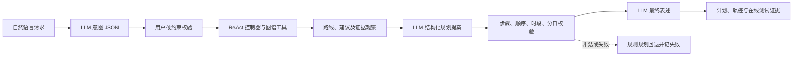
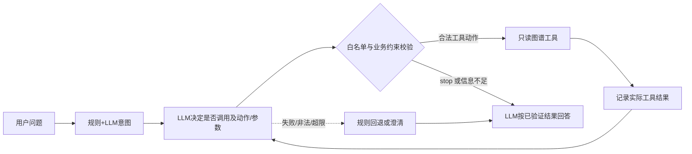

# 实验七 执行计划：程序性知识的应用

## 目标

在实验六的 471 节点 / 629 边图谱之上，构建旅游规划 Agent，满足任务书 TABLE 7 六项评分要求；不重建图谱、不重跑前序实验、不新增未审核抓取。

## 边界

- 事实只来自 `outputs/lab6/graph.json` 及其证据表；票价、开放时间、通行状态不回答。
- 工具只读，不写回图谱；所有查询留轨迹。
- 结果离线可复现；在线 LLM 为可选后端，失败即回退规则。

## 步骤

1. `src/lab7/graph_tool.py`：封装 `knowledge_graph_query`（scenics/route/advice/entity），参数白名单、异常收敛、空结果与回退标注，记录图谱 SHA-256。
2. `src/lab7/intent.py` + `data/lab7/agent_rules.json`：规则版意图解析，抽出景区/人群/天数/偏好/约束/冲突，信息不足时追问。
3. `src/lab7/llm.py` + `data/lab7/prompts.json` + `.env.example`：标准库读取本机 `.env`，接入 OpenAI 兼容后端与离线回退，provider 如实记录；真实密钥不入库。
4. `src/lab7/planner.py`：时段消歧、时序单调修复、择优、两日切分、未收录与追问分支、重复景点说明。
5. `src/lab7/agent.py`：ReAct 闭环，决策顺序显式化，逐步骤写轨迹。
6. `src/lab7/cli.py`：`--query`、`--interactive`、`--trace`、`--json`。
7. `data/lab7/scenarios.json` + `src/lab7/tests.py`：8 例场景与期望，输出 `test_cases.json`、`traces.jsonl`、`queries.json`、`meta.json`、`test_run.log`。
8. `src/lab7/figures.py`：架构图、轨迹图、时段图（PNG+SVG）。
9. `src/lab7/check.py`：当前 47 项验收，含跨实验证据来源统计、离线隔离、本地模拟 LLM 成功/失败链路与图谱规划提案校验。
10. 文档：实验七主报告、实验总结反思、运行说明与本计划集中在 `实验七/`；README、根目录 `run.ps1`、AGENTS.md 登记入口。

## 验收标准

- `python src/lab7/tests.py` 8 例期望核对失败 0 例；
- `python src/lab7/check.py` 全部通过且退出码 0；
- 方案景点可回指实验六步骤，引用证据可解析，来源覆盖 ≥2 个上游文件；
- 未收录景区、信息不足、非法工具参数均按约定收敛；
- 同一离线输入两次运行结果一致。

## 风险与已知限制

| 风险 | 处理 |
|---|---|
| 原仓库说明中的 Conda 环境与本项目目录不符 | 使用本项目环境 `D:\miniconda3\envs\dm_scenic_lab` |
| 无 `OPENAI_API_KEY` | 走离线后端，报告声明在线路径未验证 |
| 图谱时段全标“上午” | 推断补位 + 单调修复，冲突状态保留 |
| 两日游无真实线路 | 明确声明为切分方案，不冒充官方线路 |

## 2026-11-12 测试集补全计划

### 起点与方向依据

项目没有单独的总计划；本次按 README 的实验编号组织方式、课程任务书 TABLE 7（旅游规划 Agent、LLM 集成、图谱工具、Agent 编排及多场景测试）推进。前置结果以 [实验六实施与验收报告](../../实验六报告.md) 为准：图谱有 471 节点 / 629 边，38 项结构与语义检查通过，但不代表实验七 Agent 已验证。实验七现有报告确认 8 个用户场景和 30 项图谱/轨迹验收通过；仍缺独立的测试目录说明，以及真实服务的可辨认、限量验证方式。

### 目标与边界

交付一份可复跑的分层测试集与一份使用说明，覆盖业务场景、工具契约、图谱和证据、Agent 安全与轨迹、LLM 成功/异常回退、命令行和可选真实接口冒烟测试。默认执行不得访问网络或因 `.env` 中的密钥产生费用；真实服务测试由用户显式运行单次请求。测试只验证实验七已有承诺，不宣称路线现实可行、当前营业信息正确或模型普遍可靠。

### 用户场景与入口

普通使用者从仓库根目录运行 `run.ps1 -Lab 7` 获得确定性离线回归；开发者用项目 Conda 环境运行测试脚本/检查器；需要检查火山方舟或其他兼容服务时，先配置 `实验七/.env`，再通过 CLI 执行一条单次请求并核对调用计数、意图来源与回退信息。

### 工作包和验收

| 工作包 | 内容与产物 | 通过条件 |
|---|---|---|
| A 测试登记表 | 新增 `data/lab7/test_catalog.json`，为场景、工具、证据、安全、LLM 模拟、CLI 和在线冒烟用例登记唯一 ID、执行模式、步骤与预期 | 文档中每项用例都能在登记表或验收脚本找到对应 ID；区分自动、模拟及手动真实服务 |
| B 默认离线隔离 | `LLMClient(force_offline=True)`；常规场景、自动验收和 CLI 子进程显式离线；CLI 增加 `--offline` | 即使 `.env` 有密钥，`run.ps1 -Lab 7` 仍不联网、不读取密钥参与场景回归，结果可重复 |
| C LLM 可观察性与故障覆盖 | 记录尝试/成功/失败次数及脱敏错误；模拟正确请求、约束保留、非法 JSON、HTTP 失败和最终生成失败 | 自动验收区分配置存在与真实调用成功；失败时预期为规则回退并留痕，不能把模拟成功写成真实服务通过 |
| D 测试说明和报告 | 新增 `实验七/测试集说明.md`；更新运行说明、本计划和唯一实验七报告 | 文档说明怎么运行、各层测试内容、逐例预期、通过定义、在线费用/密钥边界和证据路径 |

依赖顺序：A 固定用例与通过标准 → B/C 实现隔离与故障可见性 → 在项目专用 Conda 环境运行离线套件 → D 记录真实结果。真实 API 冒烟只在用户已经填好有效凭证后，由用户显式触发；本阶段不主动调用外部付费服务。

### 测试分类及完成标准

- **场景层（8例）**：已有一日/两日、人群、自动择优、未收录景区、约束冲突、信息不足和晕车建议；核对意图、命中、天数、步骤、提示和调用数。
- **结构验收层（36项）**：原有 30 项图谱哈希/规模、景点与证据回指、来源覆盖、参数边界、轨迹完整性、时段修复、未核验声明、离线确定性与图件，加上 5 项 LLM 请求/约束/错误回退模拟及 1 项测试目录一致性检查；每项均有独立 ID 和可读结果。
- **LLM 模拟层**：正确请求路径/模型/Bearer 头、合法意图和回答、用户明确约束不可被改写、非法 JSON 回退、HTTP 错误回退、最终回答失败回退；模拟请求数与真实 API 调用严格区分。
- **真实服务单次冒烟层**：单条普通景区请求，期望意图解析和回答各 1 次成功请求，`provider` 为兼容服务模型，输出无离线回退；任何失败须显示失败阶段/错误类型且不可登记为通过。用户可选择不执行此层。
- **总体验收**：默认 `run.ps1 -Lab 7` 不联网且通过；所有自动用例全过，测试目录中每个预期有对应证据；在线真实服务尚未实际配置时明确记录“未执行”，不虚报成功。

## 2026-11-13 评分要求补强与完整在线测试计划

### 起点、方向与前序依赖

项目没有单独的课程总计划；方向以仓库 README 中“七个实验按编号衔接”和课程任务书 TABLE 7 为准。实验六验收报告确认实验七可复用的图谱为 471 节点、629 边，并且有逐条来源证据；本次不重建图谱。评分补强后，LLM 可提出受约束的分日/节奏规划并由程序校验；此前 8/8 在线通过属于旧版固定工具选择的历史结果，不能代表本阶段动态决策验收。动态决策版在线测试本次已执行，但模型服务权限拒绝，保留为失败证据。

### 目标、非目标与评分映射

本阶段先加入模型受约束规划，后按用户提供的截图进一步实现动态工具决策：LLM 按问题和已读结果选择工具或停止，程序校验参数及用户约束，工具观察进入后续决策和最终答案。任务书 TABLE 7 的对应关系为：LLM 集成（20分）→结构化模型回路；图谱工具（20分）→复用已验收工具；推理编排（截图 20 分）→决策、工具、观察、回答及容错；测试证据（20分）→离线场景、自动断言与完整在线尝试；交互复现（10分）→新增在线入口并保持默认离线。当前代码和离线验收完成，真实在线验收被服务端模型访问拒绝阻断，不能标记完整通过。

非目标：不改实验六图谱事实、不新增抓取或动态景区数据、不让模型生成图谱外地点/路线、不将模型规划当作已核验道路可达性，不改变历史测试结果。在线测试由用户明确授权，按 8 个场景顺序执行，不自动重试；最多按每场景 3 次 LLM 请求设计，实际请求数以逐案诊断为准。

### 场景、入口和目标数据流

真实在线场景复用 `data/lab7/scenarios.json` 的老人黄山、亲子九寨沟、情侣张家界、未指定景区择优、未知景区、老人冲突、信息不足和晕车建议八类输入。入口使用 `run.ps1 -Lab 7 -Online`：先跑完整离线回归，再串行跑 8 个真实在线用例；不传 `-Online` 时维持当前不联网行为。

LLM 提案只从已查得的图谱步骤中选择分组与节奏表达；程序拒绝遗漏、重复、乱序、越界的步骤编号及与用户天数不符的分日结果。模型不能新增景点、交通、设施、开放状态或票价。非法提案使用现有规则计划作为系统安全回退，但该在线用例记为未通过，以免将模型失败算成功。

### 工作包与依赖顺序

| 工作包 | 目的/场景 | 影响文件与步骤 | 输入/输出及失败行为 | 验证与完成标准 |
|---|---|---|---|---|
| A. 结构化 LLM 规划 | 对应任务书“LLM 意图解析与规划”；在图谱路线查回后让模型提出分日/节奏/说明 | `src/lab7/llm.py`、`planner.py`、`agent.py`、`data/lab7/prompts.json`；增加规划 JSON 契约、候选步骤投喂、严格结构校验，并将查询原文传入 planner | 输入用户硬约束、图谱路线步骤和已引用建议；输出受限规划提案及校验结果。网络、JSON 或约束失败时回到规则计划、诊断可见、该在线场景失败，不崩溃 | 本地模拟覆盖有效提案、非法 JSON、越界/重复/乱序/分日错误；离线场景和原规则边界不回退；至少一条真实在线规划状态为 `accepted` |
| B. 完整在线测试执行器 | 证明真实模型对任务书多场景输入的实际表现 | 新增 `src/lab7/online_tests.py`，扩展 `run.ps1` 的显式 `-Online` 参数和 `data/lab7/test_catalog.json` | 串行读取 8 个场景；逐案输出调用次数、模型响应数、回退阶段、约束结果、路线证据和最终回答；一例失败仍继续后续场景，不自动重试、不保存密钥 | 执行器可对 8 例逐案落盘、不伪通过；修复后的真实服务全套通过仍待网络可用环境验收 |
| C. 端到端证据与报告 | 对应 20 分功能证据、10 分示范及单一报告要求 | `outputs/lab7/online_test_results.json`、`online_test_run.log`、唯一 `实验七报告.md`、`测试集说明.md`；更新已有图/示范或给出在线轨迹证据 | 保存脱敏模型输出、阶段轨迹、图谱工具观察、最终结构化方案和证据 ID；不要写 API key / Authorization 头；结果失败也保留，不覆盖离线历史产物 | 至少一条完整在线轨迹展示意图→工具→观察→LLM 规划→最终答复；报告逐项对照 TABLE 7，区分达成、部分达成和未达成 |
| D. 全套复验（前一阶段历史） | 确保规划补强不破坏原功能 | 项目 Conda 环境运行离线和在线测试 | 默认路径绝不联网；在线路径串行运行、不自动重试 | 历史结果：离线 8/8、37 项验收通过；旧版在线 8/8、20 次成功。该版本没有动态 LLM 工具决策，不作为本阶段评分验收 |

依赖顺序：A 固定数据契约与安全校验 → B 建在线执行器和目录登记 → 本地模拟与离线回归 → C 更新报告与示范证据 → D 按用户当前凭证执行完整在线 8 场景，不自动重试。

### 完成边界

在线套件“完整执行”表示 8 个场景均真实请求并有结果；“在线验收通过”另要求所有预期结构/约束成立且没有模型回退。若服务限流、断连或模型输出违规，即便 8 例全部执行也不得标为通过。无匹配景区和信息不足等边界用例按规则安全返回属于预期业务结果，但用于意图解析的真实模型请求仍需成功；不要求对不可回答问题虚构路线或调用无意义的规划/回答请求。

## 2026-11-13 评分点：Agent 推理流程与工具调用编排

### 起点与评分映射

以仓库 README 中实验七方向、实验六验收报告的 471 节点/629 边图谱边界，以及报告 7.9 节为依据。原版下一步 Action 由固定 `_next_action` 状态机选择，LLM 不能按当前问题和已读结果决定是否查询路线、建议、实体或停止；本阶段目标就是补齐动态决策与轨迹，并验证决策输出安全。此前 8/8 在线通过只覆盖旧版固定工具选择。

本阶段严格对应截图中的三项：10 分闭环（解析/决策→工具→读取结果→回答）；7 分按问题选择是否/如何查图谱，并让工具结果实质进入回答；3 分有界回退、追问与错误处理。路线事实仍只能来自实验六图谱，禁止模型扩展事实。场景入口为 CLI 与 `ReActAgent.run`；覆盖路线规划、建议/晕车、实体问答、未收录景区、信息不足及工具失败。

### 目标架构与契约

在线模式由 LLM 针对每轮上下文提出一个结构化动作 `scenics|route|advice|entity|stop`、参数和简短理由；Agent 校验动作、参数、当前意图和已观察结果后才执行。每次真实工具调用都留下 Thought/Action/Observation；下一轮模型读取此前工具观察决定是否再查或结束。离线模式保留同一 ReAct 状态机和固定回退决策，不访问网络。模型动作非法、重复、超预算或请求失败时记下具体阶段，转规则动作/规则计划或追问；工具参数错误最多作有界恢复，不允许死循环。

决策 JSON 不直接接受模型生成的任意参数：action 必须在工具白名单中；景区、人群、天数受已解析意图和工具结果约束；实体名称必须短且绑定一个已收录景区；动作参数通过图谱工具现有契约；相同动作与参数不得无限重复；总工具调用仍不超过 6 次。问句未给足信息时优先追问；未收录景区只查景区清单后说明，不查其他景区路线。工具 Observation（含证据 ID、路线、建议或实体统计）必须进入后续决策及最终答案上下文。

### 工作包与验收

| 工作包 | 场景和目的 | 文件及实施 | 失败/恢复 | 验收标准 |
|---|---|---|---|---|
| A. LLM 动作决策契约 | 让问题类型和已读结果决定查询方式 | `llm.py`、`prompts.json` 新增结构化决策；`agent.py` 在每次工具前传入请求、意图、工具 Schema、观察与历史动作 | 非法 JSON、越界动作、约束冲突或接口异常均记录 decision 阶段；在线转规则决策，不能假装模型已选工具 | 单元模拟覆盖 route/advice/entity/scenics/stop 不同决策、非法动作、错误参数、重复动作与模型失败 |
| B. ReAct 执行与结果闭环 | 使真实 Action/Observation 影响下一轮决策与最终答复 | 修改 `agent.py`；只调用 `KGQueryTool.run`；观察结果作为后续决策和规划/回答输入 | 有 MAX_STEPS 与重复签名保护；工具错误进入 Observation，模型可修正一次，不能无限重试；最终回退可读 | 轨迹完整包含决策依据、Action、工具 Observation、后续决策和 Final；逐例工具选择与预期相符，回答有对应工具证据 |
| C. 场景与自动验收 | 覆盖评分项所列“不同问题”与 3 分容错 | 更新 `check.py`、`tests.py`、问题类型 fixture、测试目录、在线 runner 和结果说明 | 离线用 mock 验证所有分支，不打网络；真实在线失败保留，不能按规则回退冒充模型通过 | 在既有验收上新增 10 项断言（现共 47 项）：问题分类和工具选择、Observation 后续决策、结果进入回答、stop/追问、非法 action、安全回退；原验收不放宽；完整在线 8/8 重跑并统计决策请求 |
| D. 唯一报告更新 | 将截图评分点逐条映射到实现与证据 | 更新 `实验七报告.md` 7.4 架构、7.9 评分对照、7.10 局限；更新现有测试说明和本计划 | 保留旧失败日志和之前完整在线结果作为历史，不覆盖 | 报告说明谁做决策、工具结果如何进入答案、线上线下差异、调用上限/异常策略、完整复现命令和真实验收结果 |

依赖：先定动作 JSON 与约束 → 实现在线决策、离线回退及 ReAct 轨迹 → mock/离线全部验收 → 用户已授权的完整在线测试 → 更新唯一实施报告。代码与本地验收完成；8 个在线场景已执行，但因服务端 HTTP 403 `AccessDenied.Unpurchased`，35 次请求 0 次成功、0/8 通过。只有在模型访问权限可用后重跑并取得有效响应，才能完成真实在线验收。本阶段报告应明确代码实现与在线证据的区别，不把模拟通过写成模型通过。

### 本阶段执行结果与交付边界

| 验收项 | 结果 | 证据与结论 |
|---|---|---|
| 离线场景与回归 | 8/8 场景通过 | 默认运行强制离线，不访问模型服务 |
| 自动验收 | 47/47 通过 | 本地模拟覆盖动作决策、工具观察、回答使用结果与安全回退 |
| 真实在线场景 | 0/8 通过 | 已运行全套 8 例；35 次请求、0 次成功、0 次决策接受、35 次回退。主要为 HTTP 403 `AccessDenied.Unpurchased`，不能作为真实模型通过证据 |
| 代码交付 | 已完成 | 在线 LLM 决策、白名单和用户约束校验、工具调用轨迹、结果进入后续决策/回答、有界回退 |
| 阶段最终验收 | 部分完成 | 实现与自动验收完成；需开通当前模型访问或配置可用模型，再执行完整在线集才能完成真实模型验收 |

最新运行文件：`实验七/outputs/lab7/online_runs/20261113_175737.json`、`.log`。最新汇总同步在 `实验七/outputs/lab7/online_test_results.json` 与 `online_test_run.log`。
