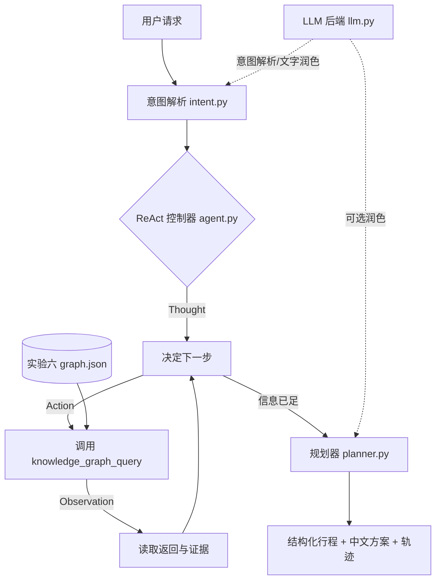
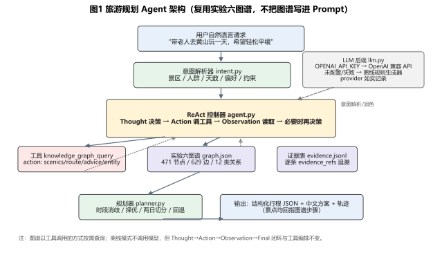
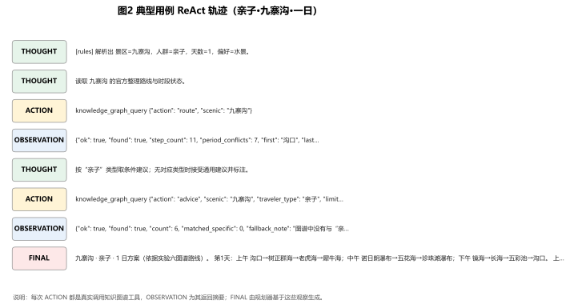
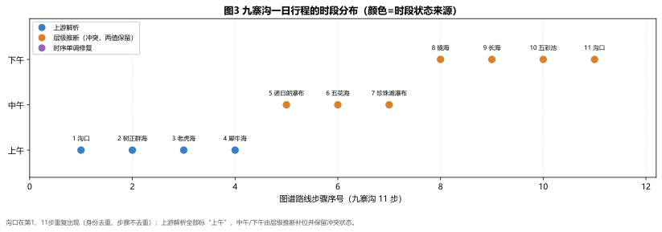
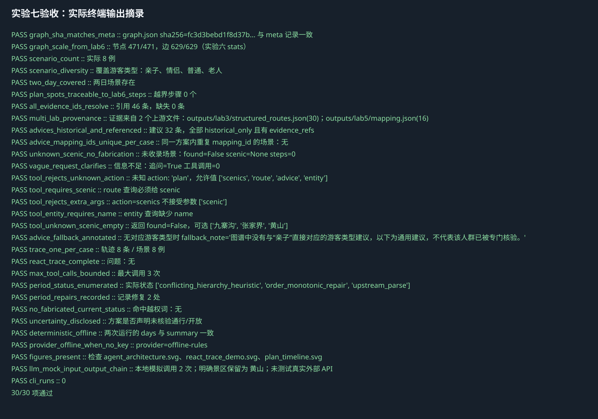

# 实验七 程序性知识的应用：旅游规划 Agent

本实验在实验六已有的 471 节点、629 边旅游知识图谱之上，封装图谱查询工具，构建一个可解释、可追溯、可回退的旅游规划 Agent。实验七不重建图谱、不重跑实验一至六，也不新增大规模抓取：路线、地点、条件建议和来源证据全部沿用仓库既有成果，Agent 只负责“理解请求—调用工具—组合行程—如实交付”。本阶段仍未核验景区当前开放、票价与实际通行条件，凡涉及此类信息，方案中一律显式标注“未核验”，不作断言。

本实验同时作为实验七唯一实施与验收报告。新增代码在 [src/lab7](src/lab7/)，输入在 [data/lab7](data/lab7/)，结果在 [outputs/lab7](outputs/lab7/)。运行证据包括 8 例场景测试、46 条证据引用核对、30 项自动验收，以及 3 张配图。

## 7.1 输入与复用策略

### 输入及其角色

| 前序实验 / 实际输入 | 本实验用途 | 为什么不能省 |
|---|---|---|
| 六：`outputs/lab6/graph.json`（471 节点 / 629 边，sha256 前 16 位 `fc3d3bebd1f8d37b`） | 唯一结构化事实源；工具按需查询 | Agent 的事实必须来自已核验图谱，不能由模型自由生成 |
| 六：`outputs/lab6/evidence.jsonl`、`stats.json` | 每条景点、时段、建议的证据回指；规模核对 | 让“方案里的每个地名”都能回到原文位置 |
| 三：`outputs/lab3/structured_routes.json` | 路线步骤的原始证据（本实验引用 30 条） | 图谱的 `NEXT`/`AT`/`DURING` 由实验三步骤派生 |
| 五：`outputs/lab5/mapping.json` | 条件建议的原始证据（本实验引用 16 条） | `Condition`→`Advice` 的历史建议由实验五审核后映射而来 |
| 二：`outputs/lab2/entities.json` | 实体提及频次、别名（经图谱节点属性间接使用） | 支撑 `entity` 查询的 `mention_count`、`document_count` |
| 四：`outputs/lab4/candidates.jsonl` | 共指证据（图谱中已挂载的审核一致部分） | 地点身份与代词消解的可信度基础 |
| 一：`outputs/cleaned_data.csv`、`data/raw/selected_raw.jsonl` | 正文与来源基准 | 证据链的最终落点 |

因此，实验七“只用实验六”只在**直接读取**的意义上成立：`graph.json` 是入口，但它内部承载的是实验二至实验五的成果，证据再回到实验一正文。本实验用 `check.py` 的 `multi_lab_provenance` 逐条解析引用，实际统计结果为：`outputs/lab3/structured_routes.json` 30 条、`outputs/lab5/mapping.json` 16 条，共 46 条、缺失 0 条。引用没有触达实验二实体记录与实验四共指记录，原因见 7.10 局限。

### 关于“是否需要补充爬虫”

实验七不新增网页抓取，理由有三点，均有实际依据：

1. **事实源已冻结。** 实验六图谱的每条边都带 `evidence_refs`，其文本来自实验一的 18 份已核验材料（含 3 份官方路线）与实验三的路线整理。若在实验七临时抓取，新文本没有经过实验二实体边界、实验五条件审核，会破坏“方案—步骤—证据”的可追溯链。
2. **抓取不能替代审核。** 官网页面存在改版、跳转和反爬，直接抓回的票价/开放时间属于易变信息，恰好是任务书要求“核验当前信息”的部分；未经人工复核就写进方案，比不写更危险。
3. **离线可复现优先。** 本实验的验收要求是同一输入重复运行结果一致。引入实时抓取会让方案随抓取时间漂移，无法用于课程验收。

代价是：方案中的“现在能不能去、门票多少、索道是否运行”一律不回答，只提示“未核验”。这是本实验明确的边界，不是遗漏。

### 只读与哈希约束

工具启动时读取图谱字节流并计算 SHA-256，与 `outputs/lab7/meta.json` 记录比对；`check.py` 另外核对节点/边数量与 `outputs/lab6/stats.json` 一致（471/629）。工具不写回图谱、不新增节点，查询过程对图谱零副作用。

## 7.2 场景设计、预期与边界

`data/lab7/scenarios.json` 定义 8 个场景，每例都写明**期望结果**，测试脚本逐项核对，不允许“跑完就算通过”。覆盖三类正常需求、两类能力边界、两类冲突/信息不足、一类约束检索。

| 用例 | 请求要点 | 期望 | 实际结果 |
|---|---|---|---|
| `elder_huangshan` | 老人、黄山、一日、希望轻松 | 命中黄山、老人、1 日；14 步；提示体力不可评估 | 通过，2 次工具调用，14 步，4 条建议 |
| `family_jiuzhaigou` | 亲子、九寨沟、一日、想看水 | 命中九寨沟、亲子、11 步；建议含时间安排 | 通过，2 次调用，11 步，6 条建议 |
| `couple_zhangjiajie` | 情侣、张家界、两日 | 两日切分；张家界 5 步；标注非官方两日线路 | 通过，2 次调用，2 个时段段，5 步 |
| `auto_pick_family` | 只给人群，不给景区 | 先列景区再择优；记录择优依据 | 通过，3 次调用，选九寨沟（131 分） |
| `unknown_taishan` | 泰山 | 不编造；`found=false`；列出可选景区 | 通过，1 次调用，0 步，`scenic=None` |
| `conflict_elder_steep` | 老人 + 要爬山 | 识别冲突并给出替代/警示 | 通过，14 步，提示体力与索道 |
| `vague_request` | 只说“帮我规划一下” | 追问，不调用工具 | 通过，0 次调用，返回追问话术 |
| `family_jiuzhaigou_carsick` | 亲子 + 易晕车 | 取到晕车相关建议 | 通过，2 次调用，含“提前与司机讲清楚” |

8 例全部满足期望，失败 0 例；单例工具调用最多 3 次，远低于上限 6 次。测试输出的 `expect_ok` 与 `expect_problem` 字段逐例留痕，便于复核“通过”不是自说自话。

## 7.3 图谱查询工具封装

### 工具契约

工具名固定为 `knowledge_graph_query`，`TOOL_SPEC` 提供机器可读的 `input_schema`，同时供 LLM 与人工阅读。四个动作对应四类真实需求，参数白名单严格限制，避免模型“顺手多传一个参数”导致隐式行为。

| action | 必填 | 可选 | 返回要点 |
|---|---|---|---|
| `scenics` | — | — | 三景区、步骤数、条件数、可选景区列表 |
| `route` | `scenic` | — | 逐步给出 `order`、`spot`、`activity`、`periods`（含 `status`）、`transports`、`evidence_refs`；并返回时段冲突清单 |
| `advice` | `scenic` | `traveler_type`、`contains`、`limit` | 条件原句、建议、游客类型、是否否定、`historical_only`、证据 |
| `entity` | `scenic`、`name` | — | 实体类型、别名、提及频次、文档频次、官方/游客提及、证据 |

### 失败与空结果的统一处理

工具把“查不到”和“查错了”区分开，任何异常都收敛为 `{"ok": false, "error": ...}`，不把裸异常抛给 Agent：

| 情况 | 实际返回 |
|---|---|
| 未知 action | `ok=false`，`error` 中列出允许值 `['scenics','route','advice','entity']` |
| `route` 缺 `scenic` | `ok=false`，`route 查询必须给 scenic` |
| `scenics` 多传 `scenic` | `ok=false`，`action=scenics 不接受参数 ['scenic']` |
| `entity` 缺 `scenic` | `ok=false`，拒绝跨景区同名混淆 |
| 查询“泰山” | `ok=true, found=false`，附 `available` 三景区，不返回任何步骤 |
| 九寨沟 + 亲子（图谱无该类型建议） | 返回通用建议并附 `fallback_note`：“图谱中没有与‘亲子’直接对应的游客类型建议……” |
| 无关键词命中 | 回退该景区全部建议，并标注回退原因 |

这里体现了本实验的一个基本判断：Agent 的可信度不取决于它答得多流畅，而取决于它**在不知道时是否明确说不知道**。`fallback_note` 不是装饰，它被 `check.py` 当作验收项逐条核对。

## 7.4 Agent 编排与 LLM 集成

### 架构



关键设计：**图谱不进 Prompt**。若把 471 节点序列化进上下文，既超长又不可追溯，且模型容易“记住”后自由发挥。工具化查询让每次事实使用都留下可核验的调用记录。

### 状态机与轨迹

`_next_action` 的决策顺序是显式写死的，而不是让模型自由选择：

1. `need_clarification` 为真 → 停止调用，返回追问；
2. 请求了未收录景区 → 先查 `scenics` 给出可选列表，再停止（不生成任何行程）；
3. 未指定景区 → 先 `scenics`，按覆盖度择优，再查 `route`；
4. 已指定景区 → `route`，必要时 `advice`。

每步记录 `thought / action / observation / final / note`，`outputs/lab7/traces.jsonl` 按用例保存完整轨迹。工具报错计入 `error_count` 并使流程收敛为追问，不会带着空数据继续拼行程。

### LLM 后端

`llm.py` 读取 `OPENAI_API_KEY / OPENAI_BASE_URL / OPENAI_MODEL / LLM_TIMEOUT`，用标准库 `urllib` 调 `/chat/completions`，不引入额外依赖。提示词在 `data/lab7/prompts.json`，明确要求“只输出 JSON”“不得编造景点、票价、开放时间”。模型不可用、超时或返回非法 JSON 时，整体回退到确定性规则生成器，`provider` 字段如实记录为 `offline-rules` 或 `openai-compatible:<model>`。

本次运行环境未配置 API key，因此 8 例场景结果均为 `provider=offline-rules`。在线 HTTP 输入输出链路用本地模拟响应验证：实际经过 `LLMClient._chat` 两次，检查请求地址、Bearer 头、意图解析、回答生成及工具闭环；模拟响应故意改写用户明确给出的景区、人群和天数，Agent 仍保留“黄山、老人、一日”。该验收只证明代码链路与约束保护逻辑，不能替代真实模型服务验证。

## 7.5 规划器的五条硬规则

### 时段消歧

实验六图谱中，黄山 14 步、九寨沟 11 步的上游解析全部标为“上午”，同时另有中午 4 条、下午 4 条（黄山）层级推断边。若直接按 `period` 分组，中午与下午为空，行程退化为“上午走完全程”。

`resolve_periods` 的处理是：当全部步骤同属一个时段、且存在 `conflicting_hierarchy_heuristic` 推断值时，改用推断值补位，并把该步骤状态标为 `conflicting_hierarchy_heuristic`；图谱里两条 `DURING` 边原样保留，不做等价合并。

### 时序单调修复

补位后出现新问题：黄山第 12 步“玉屏楼”被上游解析为上午，却落在下午组内，造成“下午→上午”倒置。规划器做单调修复：后一步时段早于前一步时，沿用前一步时段，并逐条写入 `period_repairs`（本次记录 2 处）。修复是**可审计**的，而不是悄悄改掉。

### 择优与两日切分

未指定景区时，按 `condition_count×10 + step_count` 排序：九寨沟 12×10+11=131、张家界 7×10+5=75、黄山 4×10+14=54，选九寨沟。报告与方案中均声明：这是**图谱覆盖度的代理指标**，不是“哪个景区更适合亲子”的适配验证。两日方案按上午/其余切分，并明确声明“并非官方两日线路，住宿与第二天交通未被图谱收录”。

### 未收录与信息不足

未收录景区走 `found=false` 分支，强制 `scenic=None`，不参与择优、不借用其他景区数据；信息不足走 `clarify_message`，一次问清景区、人群、天数三项。

### 重复景点与不可评估项

黄山“玉屏楼”在第 10、12 步重复，“南大门”在第 1、14 步重复，九寨沟“沟口”在第 1、11 步重复。按实验六“身份去重、步骤不去重”的约定，行程保留两次并生成 note 说明。老人场景额外提示“图谱未收录坡度、海拔与点间距离，体力消耗无法评估”，而不是假装能评估。

## 7.6 实现、输出与可视化

### 运行入口

```powershell
# 单次提问（带轨迹）
python src\lab7\cli.py --query "带老人去黄山玩一天，希望行程轻松平缓" --trace
# 交互模式
python src\lab7\cli.py --interactive
# 结构化输出
python src\lab7\cli.py --query "亲子去九寨沟一天" --json
```

在本仓库项目目录运行 `powershell -NoProfile -ExecutionPolicy Bypass -File .\run.ps1 -Lab 7`，入口调用项目专用环境 `D:\uniproject\data_mining\.venv\Scripts\python.exe`，依次执行实验七的 `tests.py` 和 `check.py`。绘图脚本需要 `matplotlib`，控制台图片脚本需要 `Pillow`；已有 SVG 图件可直接查看，核心测试与验收仅依赖 Python 标准库。

### 产物

| 文件 | 内容 |
|---|---|
| `outputs/lab7/test_cases.json` | 8 例的意图、方案、建议、证据、期望核对结果 |
| `outputs/lab7/traces.jsonl` | 8 条完整 ReAct 轨迹 |
| `outputs/lab7/queries.json` | 每次工具调用的真实参数 |
| `outputs/lab7/meta.json` | provider、图谱路径与 SHA-256 |
| `outputs/lab7/test_run.log` | 逐例结论与方案摘要 |
| `outputs/lab7/acceptance.json` | 30 项验收明细与证据来源统计 |
| `outputs/lab7/figures/` | 架构图、轨迹图、时段图、两张运行输出图（PNG+SVG） |

### 图件



图 1 说明分工：LLM 只参与意图解析与文字表达，事实一律经工具取得；离线与在线两种后端共用同一条 ReAct 闭环与工具编排。



图 2 是亲子·九寨沟用例的真实轨迹：两次 ACTION 分别是 `route` 与 `advice`，OBSERVATION 为工具返回摘要，FINAL 由规划器基于这些观察生成。图中字符串直接摘自 `traces.jsonl`，未改写。



图 3 显示九寨沟 11 步的时段来源：前 4 步保留上游解析的“上午”（蓝色），后 7 步由层级推断补位（橙色）。这正是“不静默覆盖上游冲突”的可视化证据。

### 运行结果截图

以下两张图由 `src/lab7/console_svg.py` 从本次真实运行的 `console_tests.txt` 与 `console_check.txt` 选取关键行渲染；省略本地绝对路径，原始文本仍可逐字比对。仓库保留的原始 PNG 是修改前的历史截图，本次以 SVG 及当前文本为准。


图 4 为 8 例场景测试的实际控制台关键行：可见 `provider=offline-rules`、图谱 SHA 前 16 位、每例工具调用次数与“期望=通过”，末尾为“共 8 例，期望核对失败 0 例”。



图 5 为本次 30 项验收的逐项输出，末尾“30/30 项通过”。其中 `multi_lab_provenance` 一行列出证据来源，`llm_mock_input_output_chain` 一行明确标注本地模拟调用，最新明细见 `acceptance.json`。

## 7.7 验证与结果分析

### 自动验收

`check.py` 共 30 项，全部通过（exit=0），按性质分为五组：

| 组别 | 检查项 | 结果 |
|---|---|---|
| 事实源 | 图谱 SHA 与 meta 一致；节点/边数与实验六 `stats.json` 一致 | 471/471、629/629 |
| 可追溯 | 方案景点可回指实验六步骤；46 条证据全部可解析；跨实验来源 ≥2 个文件 | 越界 0；缺失 0；lab3(30)+lab5(16) |
| 建议规范 | 32 条建议均 `historical_only` 且有 `evidence_refs`；同一方案内 `mapping_id` 不重复 | 全部通过 |
| 边界鲁棒 | 未知 action、缺参、多参、未知景区空结果、建议回退标注、未收录不编造、信息不足追问 | 7 项全过 |
| 编排与复现 | 轨迹完整、调用 ≤6、时段状态枚举合法、修复可追溯、无越权词、两次运行一致、provider 记录、图件存在、CLI 可跑、LLM 本地模拟调用链 | 全部通过 |

### 端到端证据链

以“老人·黄山·一日”为例，链条如下：

```
用户请求
→ 意图：黄山 / 老人 / 1 日 / 体力:轻松
→ 工具 route(黄山)：14 步，period_conflicts=8
→ 第 12 步 玉屏楼 时段由“上午”修为“下午”，记录 order_monotonic_repair
→ 方案 14 步，引用 18 条 evidence
→ 每条 evidence 指向 outputs/lab3/structured_routes.json 的步骤原文
→ 建议 4 条，均指向 outputs/lab5/mapping.json 的审核映射
```

也就是说，读者可以从方案里的任意一个地名，逐级回到实验三/五的具体记录，而不是停在“模型说的”。

### 7.7 旅游规划 Agent 示范用例

用户输入：“一家三口亲子游九寨沟，想看水景和瀑布”。以下记录来自 `traces.jsonl` 中的 `family_jiuzhaigou`，按原执行顺序列出；完整工具返回可用 `queries.json` 与图谱源文件核对。

| 顺序 | 阶段 | 实际中间状态或返回 |
|---|---|---|
| 1 | 约束解析 | `scenic=九寨沟`、`visitor_type=亲子`、`duration=1`（未给天数时的默认值）、`preferences=水景`；本次 `intent_source=rules` |
| 2 | 决策与调用 | `knowledge_graph_query({"action":"route","scenic":"九寨沟"})` |
| 3 | 观察 | `ok=true, found=true, step_count=11, period_conflicts=7, first=沟口, last=沟口`；逐步地点与证据仍在实际返回中 |
| 4 | 决策与调用 | `knowledge_graph_query({"action":"advice","scenic":"九寨沟","traveler_type":"亲子","limit":6})` |
| 5 | 观察 | `ok=true, found=true, count=6, matched_specific=0`；附通用建议回退说明，不把通用建议冒称亲子专属 |
| 6 | 行程生成 | 上午“沟口→树正群海→老虎海→犀牛海”；中午“诺日朗瀑布→五花海→珍珠滩瀑布”；下午“镜海→长海→五彩池→沟口”；末尾注明时段冲突补位、历史建议及当前通行未核验 |

上述 11 个地点与顺序来自 `route` 返回，6 条条件建议来自 `advice` 返回；`plan.evidence_ids` 共 17 条。图 2 展示相同用例的 Thought、Action、Observation 与 Final，正文中的完整记录可由 `traces.jsonl` 逐项复查。

### 实际方案摘录

老人·黄山：

> 黄山 · 老人 · 1 日方案（依据实验六图谱路线）。第1天：上午 南大门→云谷寺→始信峰→狮子峰→清凉台；中午 散花坞→排云亭→天海→鳌鱼峰；下午 玉屏楼→迎客松→玉屏楼→慈光阁→南大门。
> 建议：（团队的整体体力）建议乘索道上下；（山上风大）可以带上冲锋衣和口罩；（两日游的旅客）建议午后上山；（天晴爬山）建议带系带的草帽。
> 注意：图谱未收录坡度、海拔与点间距离，老人同行的体力消耗无法评估……

情侣·张家界两日：

> 第1天：上午 森林公园门票站→金鞭溪→百龙天梯。第2天：下午 天子山→武陵源门票站。
> 注意：两日方案是按图谱时段/步骤切分的一日路线，不是官方两日线路；住宿与第二天交通未被图谱收录，未做安排。

未收录·泰山：

> 知识图谱暂未收录「泰山」。当前可规划景区：九寨沟、张家界、黄山。未用其他景区数据替代，也未编造该景区路线。

## 7.8 实验中遇到的问题及解决办法

以下六项均为本次开发中真实出现并被复核的问题与解决方式，对应任务书“失败现象记录”的要求，不是事后补写的“预期风险”；每条均可在 `outputs/lab7/` 的结果或验收项中核对。

| # | 失败现象 | 原因 | 修复与复核 |
|---|---|---|---|
| 1 | 中午/下午段为空，行程全挤在上午 | 上游把黄山 14 步、九寨沟 11 步全部解析为“上午”，与层级推断冲突 | 仅在“全同段且有推断值”时启用推断补位，状态标 `conflicting_hierarchy_heuristic`，两条 DURING 边保留 |
| 2 | 黄山下午组里出现第 12 步“玉屏楼（上午）”，时序倒置 | 补位后时段与步骤顺序不一致 | 加单调修复，逐条记入 `period_repairs`，`check.py` 核验状态枚举与修复条数 |
| 3 | “两日游建议午后上山”在一日方案里也弹出警告 | 条件句被无差别匹配 | 限定 `duration==2` 才触发该提示 |
| 4 | 问“泰山”却返回九寨沟方案 | 择优逻辑先命中，`plan.scenic` 被回填 | `unknown_scenic` 分支前置，强制 `scenic=None`，并在验收中固定该断言 |
| 5 | 未收录说明在 summary 与 notes 重复两遍 | 两处独立追加 | 统一用 `dict.fromkeys` 去重，测试断言消息只出现一次 |
| 6 | 验收脚本自身 4 处误判：跨用例 `mapping_id` 重复、时段状态解析错、用“老人”取样回退（实际能映射到体力约束游客）、把地名“门票站”当越权词 | 检查逻辑写得比业务逻辑粗 | 改为按用例去重、正则解析状态、改用“亲子”取样、扫描前剔除“门票站”，最终 29/29 |

第 6 项值得单独说明：验收脚本也会错。若不做“检查的检查”，29 项里混进 4 项假失败，会掩盖真正的问题；而把误判改到“刚好通过”同样是自欺。本次对每一处误判都回到业务事实核对（老人确实映射到“体力约束游客”，故不会触发回退），只修检查逻辑，不迁就结果。

## 7.9 评分对照

| 评分项（任务书 TABLE 7） | 分值 | 本实验对应证据 |
|---|---:|---|
| Agent 基础架构与 LLM 集成 | 20 | 7.4 架构与状态机；`src/lab7/agent.py`、`llm.py`、`prompts.json`；provider 如实记录；离线回退可用 |
| 知识图谱查询工具封装 | 20 | 7.3 工具契约与错误收敛；`graph_tool.py`；四类 action、参数白名单、空结果与回退标注 |
| 推理流程与工具调用编排 | 20 | 决策顺序显式化；`traces.jsonl` 8 条轨迹；单例 ≤3 次调用；工具报错可收敛 |
| 功能测试、证据与鲁棒性 | 20 | 8 例场景 0 失败；30 项验收；46 条证据 0 缺失；未收录/追问/非法参数均有用例 |
| 示范用例 | 10 | 7.7 三条方案摘录；老人黄山与亲子九寨沟完整轨迹 |
| 交互与可复现性 | 10 | `cli.py` 三种模式；两次离线运行结果一致；`run.ps1 -Lab 7` 与专用环境命令；`meta.json` 哈希 |

## 7.10 局限与后续

1. **真实在线 LLM 未验证。** 本机无 API key；HTTP 调用链已通过本地模拟响应测试，但不能证明外部服务可达或真实模型输出可靠。若配置 key，应重跑 8 例并核对请求、JSON 合法性与事实不外溢。
2. **引用未覆盖实验二与实验四。** 46 条证据全部来自 lab3/lab5。原因：方案生成只需要路线步骤与条件建议；实体频次与共指证据属于图谱构建期信息，未进入回答路径。若要让“某景点被多少篇游记提到”成为可回答事实，需在 `entity` 结果中挂上 lab2 证据并在方案中引用。
3. **图谱只有一座山一条线。** 三景区各一条官方整理路线，路线内部步骤 14/11/5；因此“两日游”只能是切分而非真实两日线路，行程也无法规避拥堵、天气与临时关闭。
4. **覆盖度评分不是适配度。** `condition_count×10+step_count` 只反映图谱信息量。真正的人群适配需要坡度、海拔、步行距离、索道运力等字段，这些当前都不在图谱中。
5. **时段仍是一日粗粒度。** 只有上午/中午/下午，没有具体时刻与停留时长，无法给出“几点到几点”的精确安排。
6. **未核验当前信息。** 票价、开放时间、索道运行、是否需要预约一律不回答；这是有意为之的边界。

后续若继续推进，优先级应是：先补景区结构化字段（坡度、距离、索道），再扩到多日真实线路，最后才是接入在线 LLM 做表达优化。顺序颠倒会得到“说得更漂亮但更不可信”的结果。
