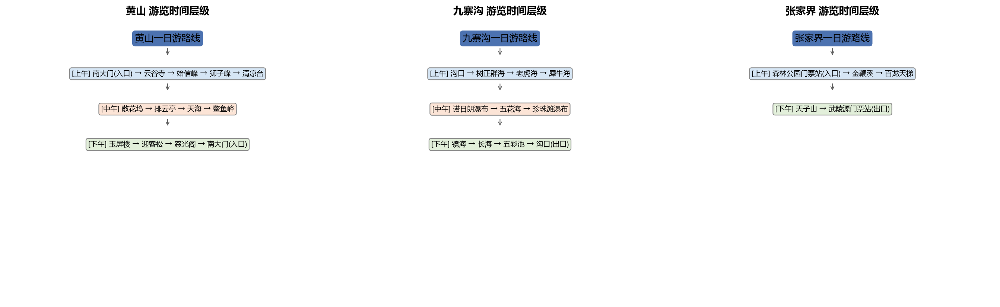
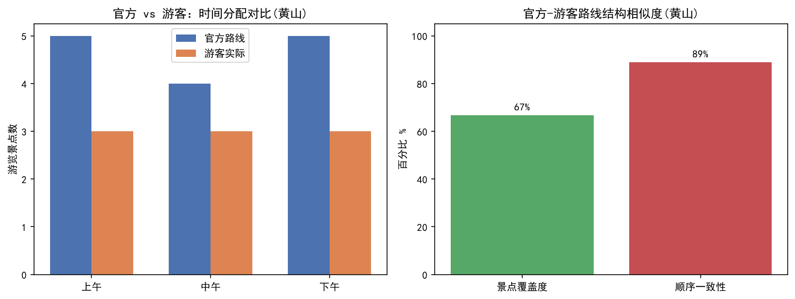

# 实验三 游览路线层级结构挖掘

当前使用远端提交 `6d4750c` 的黄山、九寨沟、张家界版本，已于2026-11-05迁入项目统一目录。此文件是现行入口和结果说明；完整上游Word及问题记录保留在 `archive/lab3/latest_6d4750c/`，不重新生成Word。

## 输入和处理流程

| 模块 | 作用 | 输入 → 输出 |
|---|---|---|
| `src/lab3/build_dataset.py` | 汇总保存的采集事实、语料及代码内整理路线 | `data/lab3/raw/crawled_pages.json`、`data/lab3/processed/industrycorpus_tourism_sample.json` → `scenic_dataset.json` |
| `src/lab3/parse_route.py` | 识别箭头、编号、时间分段，提取景点、活动、时间、步骤 | 数据集 → `outputs/lab3/structured_routes.json` |
| `src/lab3/time_hierarchy.py` | 组织上午、中午、下午层级 | 路线 → `time_hierarchy.json`、`figures/time_hierarchy.png` |
| `src/lab3/compare_routes.py` | 比较黄山官方路线与脚本内置游客叙述 | 路线＋内置文本 → `route_compare.json`、`figures/route_compare.png` |

实验三现覆盖与实验二一致的三个景区，但其具体路线样本仍是独立整理文本，不等同于实验一三篇官方原文。实验六关联时仍需核对来源、别名、父子区域和交通设施，不可仅因景区名相同就视为同一条路线。

## 运行方式（命令行）

```powershell
Set-Location D:\data_lab\scenic_lab1
powershell -NoProfile -ExecutionPolicy Bypass -File .\run.ps1 -Lab 3
```

使用专用环境 `D:\miniconda3\envs\dm_scenic_lab`。默认只使用已有输入，依次执行上表四个脚本；手动联网采集入口为 `src/lab3/scenic_crawler.py` 和 `src/lab3/load_industrycorpus.py`，不参与默认运行。上游 `run.py` 会联网，保留在归档中作为历史入口。

## 复跑结果与边界

本次离线复跑成功，三景区路线、时间层级和黄山对比三份JSON与远端原版相同。黄山官方路线14个步骤，游客示例9个去重景点；覆盖率66.7%，现有顺序指标88.9%，遗漏云谷寺、慈光阁、排云亭、散花坞。重复景点和出入口角色均按上游结果保留，本次不改算法。





游客对比文本来自代码内置 `TOURIST_NOTE`，不能冒充实验一的真实游客记录。现有 `lcs_length` 实际使用 `SequenceMatcher`，不应普遍解释为严格最长公共子序列算法；部分时间分配为近似，构建器缺源文件可能使用空列表回退。目录整理验证不等同于独立算法精度验收。

版本、迁移和验证详情见 [目录整理实施验收报告](docs/目录整理实施验收报告.md)。
