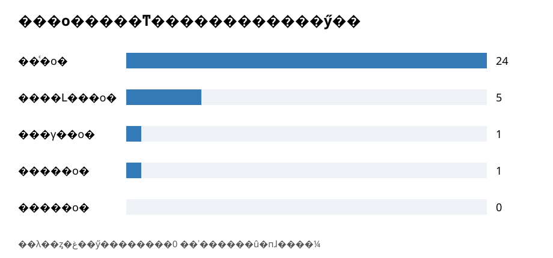

# 实验五：条件性游览建议的抽取

## 5.1 输入与抽取规则设计

输入为实验一的 `outputs/cleaned_data.jsonl`，包含黄山、九寨沟、张家界各 1 篇官方指南及 5 篇游客游记，共 18 篇。只抽取**原文中可定位的条件与行动建议**，不从“可以”“建议”单独推测条件。本实验评价的是文本抽取方法：映射表忠实记录原文曾提出的建议，并保留来源及位置。部分游记写于较早年份，涉及的售票、交通和景区状态可能变化；**这属于原文的时间属性，并非代码或抽取结果损坏**。本表不能直接充当当前旅游服务指南，后续对外提供行程建议前需另核验现行信息。

程序先按句号、问号、叹号、分号、换行及英文句点分句；以字符偏移记录来源。规则按下列优先级尝试：①带逗号的“如果／假如／若是／若／只要／一旦……，建议／可以／就……”；②无逗号的“如果……不建议／可以……”；③“由于……，建议……”及“两日游旅客建议……”等显式场景；④“因为……，所以……”且后件确为行动建议；⑤天气、体力、时间场景词与建议相邻的表达；⑥“道路平缓，建议……”等路况、风险表达和“因为考虑到团队体力，导游建议……”等因果表达。同句多次出现条件触发词时逐个尝试，防止只取第一个条件。条件部分若只剩“可以”等情态词，或行动出现在后续另一条件之后，则剔除；后件首分句须有建议或行动信号，避免把“就会湿身”当作行动。单独的“可以观赏”“建议购买”等无明确条件句进入审计。缺少独立指代对象的表达（如“放得下”“可以不用去”“先到这”）暂不进入映射，过滤结果留在审计日志中。规则候选仍须人工核验，不能直接视为真值。

## 5.2 批量抽取与复杂表达处理

`src/lab5/extract.py` 扫描全部 18 篇，产生 **34 条规则候选**，并将没有形成明确条件—建议对的触发片段写入 `outputs/lab5/audit.jsonl`。每条候选保存 `doc_id`、景区、来源名称和记录号、原句、条件／建议文本及各自的起止位置。位置均相对清洗后的 `clean_text`，从零开始，结束位置不包含在内。代码验证抽取片段与原文相符。无逗号及“由于”规则已能自动发现“一天时间相对紧凑→早点出发”“要买特产→不要在景区买”等案例；新增场景、路况和风险建议规则，并在同句多次出现“如果”时逐个尝试匹配，使“两日游的旅客建议午后上山”“道路平缓，建议不坐小火车”等进入规则候选。剩余复杂并列条件仍在人工补充表中，不伪装成自动识别结果。

对于一句中的多项建议，先按有独立行动词的逗号分段，在审核记录中核对各建议对应的条件。例如“如果天晴爬山建议带系带的草帽，山上风大可以带上冲锋衣和口罩”，最终拆成“天晴爬山→带草帽”与“山上风大→带冲锋衣和口罩”。“如果体力不是很好，可以放弃镜海栈道”与同句前后的其他“如果”各有对应建议；第一轮未正确切出，改进后由规则产生候选，逐条审核时将后续原因说明从建议边界中剔除，不把上一条件错误地继承给该建议。

如表 5-1 所示，正式表保留了条件、建议、类型和来源位置。可追溯的详细记录见 `reviewed_pairs.jsonl`。

**表 5-1 条件—建议抽取样例**

| 景区与来源 | 条件 | 建议 | 条件类型 | 来源位置 |
|---|---|---|---|---|
| 黄山；游客游记 HS-T01 | 山上风大 | 可以带上冲锋衣和口罩 | 天气季节 | 条件 629—633；建议 633—643 |

## 5.3 映射表、分类与去重

审核记录 `manual_review.csv` 对 34 条候选逐条给出保留／剔除及理由，保留 29 条；`manual_supplements.csv` 从原文补充 2 条，形成 **31 条**审阅后的条件—建议对。`finalize.py` 对条件和建议去空白、标点及常见建议前缀，以“景区＋条件”约束合并范围；只有建议文本相同或存在前后缀包含关系才合并，且保留所有来源。**本批 31 条没有满足合并条件的重复，去重前后均为 31 条**；不能为展示去重效果而强行合并语义不同的建议。并列条件与同句多个条件的边界在审核时单独核对，详见表 5-2。小组人工抽查记录见 5.4 节。

最终 `mapping.json` 和 `mapping.csv` 包含映射 ID、条件类型、条件描述、建议内容、景区、游客类型及来源线索。对“这条沟”“走这”等缺少独立地点名的建议增加 `needs_context_resolution` 标记，本批有 **4 条**；下游须结合原文上下文消歧，不能直接变成面向用户的当前行程建议。条件类型由天气季节、体力路况、时间安排、路线偏好、交通可达和其他显式条件组成；游客类型由条件和建议中明确出现的人群词判定，未明确限定的归普通游客。当前样本的条件类型计数如下，统计单位为去重后的映射条数。

| 条件类型 | 数量 |
|---|---:|
| 时间安排 | 8 |
| 天气季节 | 5 |
| 体力路况 | 6 |
| 交通可达 | 4 |
| 路线偏好 | 2 |
| 其他显式条件 | 6 |

## 5.4 人工校验与误差分析

现有审核记录覆盖全部 34 条规则候选：29 条保留，5 条剔除，并检查条件与建议边界、景区、分类及原文偏移；另从触发审计和原文补充 2 条。规则预先过滤了 5 条缺少独立指代对象的候选，仍保留在 `audit.jsonl` 中；过滤前的逐条判断另存 `review_before_reference_filter.csv`，可供复核。表 5-2 展示误抽、漏抽和边界修正；表 5-3 给出数量对账。

可计算的过程指标为：候选保留比例 **29/34＝85.3%**；在目前已发现的 31 条有效配对中，当前规则直接得到 **29/31＝93.5%**。后者仅是“已知有效配对中的规则捕获比例”，不是全语料召回率，因为未把全部未命中句逐条标注。31 条记录均经过原文位置核对，但这也不是独立测试准确率。保留比例分母因规则过滤而从 39 降至 34；相应五条排除记录仍可追溯，不能把分母变化说成模型泛化能力的证明。

两项过程比例相比最初规则（17/30＝56.7%、17/29＝58.6%）均有提高。陈颖于 2026 年 11 月 3 日从黄山、九寨沟、张家界的结果中抽查 5 例：3 例确认保留、1 例确认剔除、1 例确认按原文补充，涵盖同句多个条件和路况建议；本次未产生新的修订。抽查范围、原文依据和逐例意见见 `outputs/lab5/人工抽查记录.md`。程序对 34 条候选保存了逐条审核记录，小组人工抽查则重点复核了其中具有代表性的处理结果，符合本实验“人工抽查并分析误抽、漏抽和边界”的要求。29/34 衡量候选经审核后的保留比例，29/31 衡量本批已发现有效配对中规则直接找到的比例；它们用于展示本次规则改进成效。最终 31 条映射是规则候选经过审核与补充后的产物。后续实验六应使用 `mapping.json` 中保留原文位置的审核结果，并将“原文建议”与“当前有效旅游信息”分开；实验七提出当前行程建议前还须核验开放、交通和票务条件。

**表 5-2 误抽、漏抽与边界案例**

| 类别 | 原文线索与记录 | 处理及原因 |
|---|---|---|
| 误抽 | JZG-T03：“如果是下午飞还可以再吃一回” | 原句表达作者对机票和用餐的个人遗憾，不是景区游览行动建议；规则还把“还”错划入条件，故剔除。 |
| 规则漏抽后补充 | JZG-T01：“不想走栈道，也不想去诺日朗瀑布……直接顺公路……” | 原句确有并列偏好条件及替代路线建议；规则未找到，依据原文补充。“那个观景台”需结合前文消歧。 |
| 边界修正 | HS-T01：“天晴爬山建议带系带的草帽，山上风大可以……” | 两个条件分别对应各自建议，不合并为一条。 |
| 缺指代对象 | JZG-T03：“没时间，可以不用去” | 缺少独立景点对象；规则过滤，审计日志留痕。 |

**表 5-3 抽取与审核数量对账**

| 扫描文本 | 规则候选 | 审核保留 | 审核剔除 | 原文补充 | 去重前／后 |
|---:|---:|---:|---:|---:|---:|
| 18 | 34 | 29 | 5 | 2 | 31／31 |

表 5-3 来自 `stats.json`。历史票价、临时维修状态和药物描述被排除或仅保留为历史文本，不作为现行旅游建议。抽查依据及结论已记在 `outputs/lab5/人工抽查记录.md`；其中第 3 例的边界错误和第 4 例的规则漏抽属于开发阶段已识别并处理的案例，本次人工抽查确认了最终处理。

## 5.5 分类统计与可视化

按游客类型分组：普通游客 24 条、体力约束游客 5 条、易晕车游客 1 条、亲子游客 1 条、老年游客 0 条。图 5-1 用柱状图展示数量。这里的“普通游客”表示原文未明确限定特定人群，不等于建议适用于所有人；空类别只表示本批可核验样本没有对应记录，不能编造条件建议补齐。亲子类别来自“给自己和娃们都带上换的衣服”；原文虽出现老人，但没有足够明确且可核验的老人条件—行动建议进入本表。

**图 5-1 按游客类型分组的条件—建议映射条数。** 单位为去重后映射；0 为样本稀疏，并非该类游客不需要建议。

## 运行与复现

在项目目录执行 `powershell -NoProfile -ExecutionPolicy Bypass -File .\run.ps1 -Lab 5`。入口依次生成规则候选、人工审核后的映射表、统计及配图。查看 `outputs/lab5/` 下的 `candidates.jsonl`、`manual_review.csv`、`manual_supplements.csv`、`reviewed_pairs.jsonl`、`mapping.json`、`mapping.csv`、`stats.json` 与 `figures/` 即可逐项核验。人工审核文件固定在仓库中；复跑不会自动改写它们。
