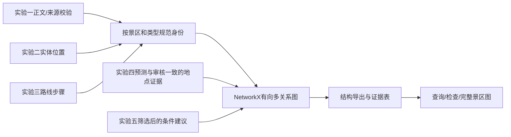
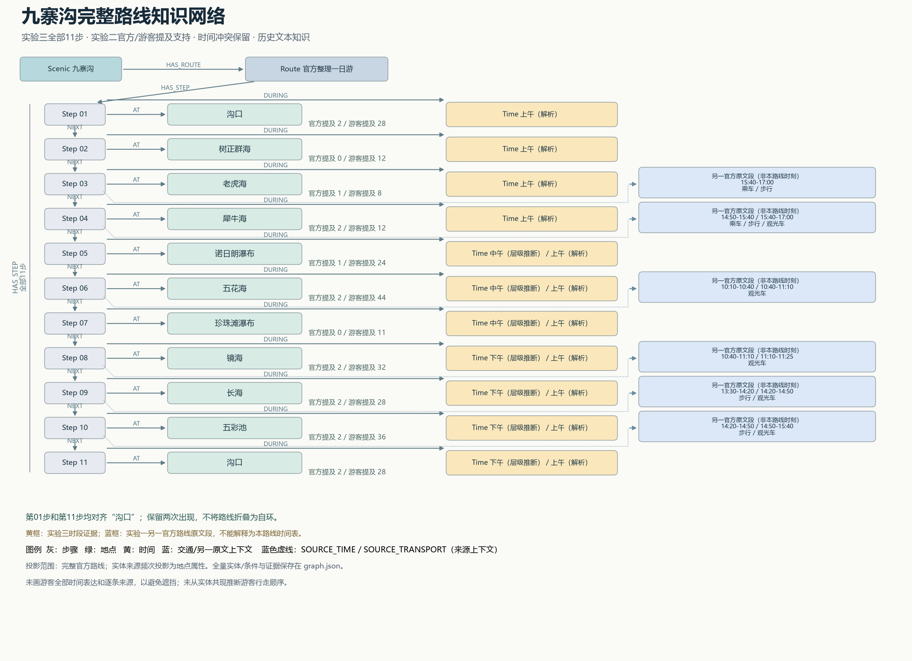
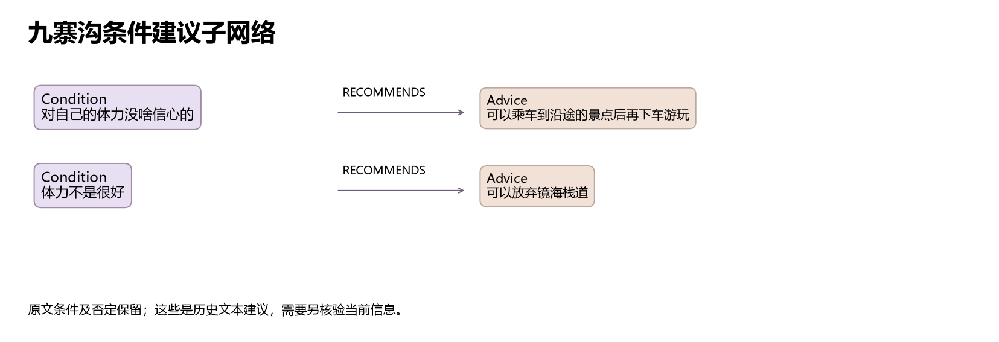

# 实验六 多源程序性知识的融合与图谱可视化

本实验将实验二的实体与最新版实验三的三景区路线关联，并使用实验一的正文与来源核对、实验四的审核后指代证据、实验五的条件建议，构建可读取、可查询、可追溯的知识图谱。图谱是“实体及其关系组成的网络”，用于表达材料中说过什么、路线如何组织；本阶段没有实现实验七Agent，也没有核验当前开放、票价及实际通行条件。

实验三采用远端提交 `6d4750c` 对应的黄山、九寨沟、张家界版本。此前旧版实验三与实验六已按用户明确要求删除。本文同时作为本阶段唯一实施与验收报告；计划见 [实验六执行计划](docs/实验六执行计划.md)。本次使用NetworkX 3.6.1实际构图，最终有 **471个节点、629条边、8类节点、12类关系**；质量判断依据是来源、身份与关系核验，而非节点数量。

## 6.1 输入关联与融合策略

### 输入及其关联方式

| 前序实验 / 实际输入 | 本实验用途 | 关联键和版本约束 |
|---|---|---|
| 一：`outputs/cleaned_data.csv`、`data/raw/selected_raw.jsonl` | 18篇正文及来源基准；CSV正文SHA-256与记录内指纹一致，original_text与原始JSONL一致 | `doc_id`；正文指纹；景区；字符起止位置 |
| 一：`outputs/cleaned_data.jsonl`、`quality_report.json`、`cleaning_audit.csv` | 诊断当前JSONL格式问题；保留清洗质量和来源背景 | 文件哈希记录在manifest；不将旧质量报告当作当前损坏文件可解析的证明 |
| 二：`outputs/lab2/entities.json`、`iteration.json` | 2015次景点、交通、时间提及；沿用已优化的实体边界，了解上游已排除的邻近地名和时间误匹配 | `doc_id + start + end`定位；身份按`景区 + 类型 + 审定名称` |
| 三：`outputs/lab3/structured_routes.json` | 三条路线、30个步骤；路线内重复景点保留为不同步骤 | `scenic`；路线ID；`step_no`；`spot`对齐规范名 |
| 三：`time_hierarchy.json` | 对比上游时间层级与解析结果，不静默覆盖 | 景区＋步骤序号；冲突保留两条带状态的时间关系 |
| 三：`route_compare.json`、`data/lab3/processed/scenic_dataset.json` | 识别内置游客示例及无可确定景区的补充语料，控制来源边界 | 内置游客示例仅作上游对比证据，不冒充实验一真实游客路线；不强挂混合语料 |
| 四：`outputs/lab4/candidates.jsonl`、`full_review.csv` | 给地点实体附加有审核依据的代词消解证据 | 候选ID；预测与既有审核一致；先行词必须精确对应实验二实体位置 |
| 五：`outputs/lab5/mapping.json` | 条件、建议、游客类型和来源位置；筛选后纳入23条，隔离8条 | `mapping_id`及每个来源的`doc_id`、条件/建议位置 |
| 本阶段：`data/lab6/rules.json` | 可审阅的别名、歧义、交通设施、条件排除和关系端点规则 | 版本随代码保存；不使用隐式模糊匹配 |

这里的字符位置是Python字符索引，从0开始，结束位置不包含在片段内。输入指纹清单在 [input_manifest.json](outputs/lab6/input_manifest.json)。原始前序文件不被本实验改写。

本地 `cleaned_data.jsonl` 因既有编辑不再满足一行一个合法JSON对象的约定。本实验未猜测修补：程序捕获解析错误，读取同阶段CSV；确认18篇正文指纹、原始文本一致，并逐个验证2015次实体提及的正文切片，才继续构图。恢复后的只读使用快照保存为 `data/lab6/documents_snapshot.jsonl`。这个处理使实验六可复现，但不代表原损坏JSONL已经修好。

### 身份对齐、来源与去重

融合流程如下。官方材料和游客游记共享地点身份，但不共享未经核验的路线或结论。



1. **限定同景区、同类型。** 别名只在指定景区内生效，不用字符串包含或编辑距离自动合并。“百龙天梯”归交通，不同时生成景点身份；具体“云谷索道”“太平索道”分开，避免沿用实验二统计时统一为“索道”的粗粒度名称。
2. **实体身份与路线出现分开。** 同一“沟口”只有一个地点节点，但路线第1步和第11步分别保存。`NEXT`连接步骤，而不是删除重复地点后重新拼接；官方和游客文本中的所有实体也不会按共现顺序被硬串为游客路线。
3. **来源合并保留原证据。** 同一实体聚合 `evidence_refs`，每条证据有来源文件、记录/步骤位置、类别、原文或切片、可用URL；实验一记录还保存原分片和记录号。缺少原网页URL的游客文本用空值表示，不拿数据集网址冒充原网页。
4. **频次不充当概率。** `mention_count`只计实验二唯一实体证据位置，`document_count`计不同文档；`official_mentions`和`tourist_mentions`分列。实验三步骤和实验四共指不会重复抬高提及频次。`support_class`仅分多文档支持/单文档或路线支持，不是经过校准的置信概率。
5. **同一事实边按身份去重。** 边标识包含两端、关系和关系属性；相同边合并证据。来源不同或时间状态不同可以保存平行边，不能把冲突抹平成一个值。

实际路线对齐覆盖如下。表中分母按步骤出现次数计，含回到入口及重复经过同一地点，不是独立实体数，也不是精度指标。

| 景区 | 实验三步骤 | 对齐到已有实验二提及的步骤 | 路线有而实验二无提及的名称 |
|---|---:|---:|---|
| 黄山 | 14 | 7 | 南大门、清凉台、散花坞、天海、玉屏楼；部分名称重复出现 |
| 九寨沟 | 11 | 11 | 无 |
| 张家界 | 5 | 3 | 森林公园门票站、武陵源门票站 |
| 合计 | 30 | 21 | 未匹配者仍保留实验三来源，不补造游客提及 |

实验一和实验三虽然景区相同，具体官方路线文本及来源不同。例如排云亭实体同时有实验一官方记录和实验三整理路线证据；不能因二者都属黄山就说是同一条路线。真实游客来源主要通过实验二地点/交通/时间提及，以及实验五条件原句进入图谱；实验四进一步附加11条审核一致的地点指代证据，19条候选不自动接受。

## 6.2 对齐样例与噪声诊断

### 可以合并与不能合并的实际例子

| 样例 | 本组决策 | 依据与保留信息 |
|---|---|---|
| 九寨沟“诺日朗中心站”“诺日朗换乘站” | 同一Place，规范为诺日朗换乘站 | 继承上游已核对的局部别名；保留两种表面名。实际13次提及、4篇文档，官方2次、游客11次 |
| 张家界“武陵源东门”“武陵源景区东门” | 同一Place | 入口简称规则明确，只在张家界语境生效 |
| 九寨沟“沟口”“沟口(出口)” | 同一Place、不同Step | 括号在此表示行程角色，不是另一个地点；第1/11步均保留 |
| 西海大峡谷 / 西海大峡谷谷底 | 不合并 | 区域与子区域不等同，名字包含不构成同义 |
| 珍珠滩 / 珍珠滩瀑布 | 不合并 | 滩区与瀑布不是同一名称对象，不使用前缀包含去重 |
| 云谷索道 / 太平索道 | 不合并 | 同属索道交通统计类不代表同一设施 |
| “百龙天梯” | Transport；路线Step用USES连接 | 避免实验三景点字段把交通设施变成Place |
| 森林公园门票站 / 武陵源景区南门 | 保持不同身份 | 上游名称缺乏足够同一性证明，本组未强行建立别名；可能留下重复身份，列为待核查 |

完整逐条对齐记录见 [alignment.json](outputs/lab6/alignment.json)，规则见 [rules.json](data/lab6/rules.json)。同名跨景区也保持不同ID。

### 实际噪声处理及影响

- **歧义“诺日朗”：31次提及隔离。** 它可能指瀑布、区域或换乘点，不能一律映射到诺日朗瀑布。图中仍保留明确命名的诺日朗瀑布与换乘站。这会降低模糊文本的召回，但避免错误合并；C006建议原文中的“诺日朗”不被自动补为瀑布目标。
- **低频保留：182个实体节点仅有一次实验二提及。** 它们涵盖地点、交通和时间，不因此删除。例如黄山“白鹅山庄”出现一次，原文位置有效，所以保留。相反，高频也不能解除“诺日朗”的语义歧义。频次受文档长短和重复描述影响，并不表示景点重要性或真实性。
- **时间冲突：15处步骤的解析时段与层级时段不同。** 本实验分别生成 `upstream_parse` 和 `conflicting_hierarchy_heuristic` 状态的DURING关系；黄山第12步不在上游时间层级中，只保留解析结果，不制造另一时间值。这些数据适合显示方法差异，不适合直接排出可执行时间表。
- **条件建议：31条中23条进入图、8条隔离。** C007、C008、C022、C030有未消解指代；C002涉及周边飞龙瀑下口，C003涉及重庆/昆明返程，C019原文明确在谈黄龙缆车，C023为购买电池的通用消费建议。每条均保留排除理由和原来源证据，见 [advice_audit.json](outputs/lab6/advice_audit.json)。排除范围是本组景区游览图谱范围，并不判断原建议必然错误。
- **指代消解：30条候选附加11条证据。** 必须同时满足审核为POI、预测与审核先行词一致、先行词位置精确命中实验二实体；人物、区域不明、不一致或无法定位者隔离。既有审核并非本阶段独立新增人工标注，规则仍可能继承其偏差。
- **来源类别控制。** 实验三内置 `TOURIST_NOTE` 只保留为示例比较的诊断记录，不作为真实游客路线；数据集中未可靠归属的补充游记也不强挂景区。没有把官网导航或关键词命中的混合文本当作路线事实。

局限是本组规则依赖有限语料和人工审定别名；尚未完成全量实体身份的独立人工真值标注。保留细粒度身份避免过度对齐的同时，可能有漏合并；时间表达只做精确文本身份，不把“早上”与“上午”、各种时长表达自动等同。

## 6.3 图谱模式（Schema）设计

Schema即“节点、关系与属性的结构约定”。本实验采用有向多关系图，同一对节点可有多条不同类型或不同证据状态的边；完整机器约束见 [schema.json](outputs/lab6/schema.json)。

### 节点

| 类型 | 标识与含义 | 核心属性 |
|---|---|---|
| Scenic 景区语料范围 | 类型＋景区＋名称散列；3个 | label、scenic、scope。表示本组文档范围，不证明辖区地理边界 |
| Place 地点 | 类型＋景区＋审定规范名散列；106个 | aliases、提及/文档数、官方/游客频次、来源类别 |
| Transport 交通 | 类型＋景区＋设施/方式规范名；52个 | 具体设施身份保留；通用方式如步行也可独立存在 |
| Time 时间表达 | 类型＋景区＋原时间文本；231个 | 原表达及证据；具体钟点、时长和时段不互相折算 |
| Route 路线 | `route:景区`，代表本批每景区一条实验三路线；3个 | 官方整理路线标题、来源证据；若扩到多路线需扩展路线ID策略 |
| Step 操作/步骤 | `route:景区:step:序号`；30个 | order、activity、activity_status、route_id；重复地点的不同出现独立保存 |
| Condition 条件 | 类型＋景区＋条件原文散列；23个 | condition_type、traveler_type |
| Advice 建议 | `advice:mapping_id`；23个 | 原建议、historical_only、negative、mapping_id |

每个节点有 `evidence_refs`。稳定散列使用SHA-256前20位，不用每进程随机变化的Python hash。当前3条路线的标识契约适用于本批输入，不宣称已支持同景区任意多条路线。

### 关系、方向与语义

| 关系 | 起点 → 终点 | 属性/语义 |
|---|---|---|
| HAS_ENTITY | Scenic → Place/Transport/Time | 在该景区语料中被提及，不解释为物理包含 |
| HAS_ROUTE | Scenic → Route | 该景区的实验三路线 |
| HAS_STEP | Route → Step | order；保留全部步骤 |
| AT | Step → Place/Scenic | 步骤所指地点；不把交通设施作为Place |
| NEXT | Step → Step | 同路线序号相邻，表示上游文本顺序；不保证道路连接、合理先后或当前可达 |
| DURING | Step → Time | status区分解析时间与冲突层级推断 |
| USES | Step → Transport | 设施本身步骤，或同一操作分句中匹配该具名设施；同一步骤同一设施仅一条边 |
| SOURCE_TIME | Step → Time | 另一官方原文箭头段的时间上下文；保留source_doc、原文起止位置及整段范围，不赋作该步骤时刻 |
| SOURCE_TRANSPORT | Step → Transport | 另一官方原文箭头段的交通上下文；必须有精确地点端点与实验二实体位置；不声称实验三该步采用它 |
| HAS_CONDITION | Scenic → Condition | 该景区范围内的条件建议 |
| RECOMMENDS | Condition → Advice | 边属性保留condition、advice、traveler_type、condition_type；是原文的条件建议断言 |
| MENTIONS | Advice → Place/Scenic/Transport/Time | 只连接条件/建议片段内有精确实体位置的目标；“放弃镜海栈道”也仅是提及，不转成推荐访问 |

关系均有证据引用。`Condition → Advice`即使建议是否定也保留原措辞；不擅自将“不坐小火车”变成“乘小火车”边。未解决的指代不会生成错误目标关系。

## 6.4 构建实现与结构化输出

### 实现与运行入口

```powershell
Set-Location D:\data_lab\scenic_lab1
powershell -NoProfile -ExecutionPolicy Bypass -File .\run.ps1 -Lab 6
```

统一入口固定使用 `D:\miniconda3\envs\dm_scenic_lab\python.exe`，关闭用户级包加载并启用UTF-8；依次运行构图、查询、绘图、检查。任一子进程失败立即终止。依赖见requirements.txt、environment.yml，实际NetworkX版本3.6.1。本实验不调用在线模型或付费接口。

| 模块 | 为什么存在及主要输入输出 | 错误与验证 |
|---|---|---|
| [build.py](src/lab6/build.py) `Fusion.run` | 校验原文与实体，构建稳定身份、步骤、来源、指代与条件；写图结构、审计及统计 | 缺文件、正文指纹错、实体/条件/指代位置错拒绝；已验证全量实体与来源位置 |
| [enrichment.py](src/lab6/enrichment.py) `local_modes/enrich` | 单分句约束具体设施使用，按官方箭头段端点和实体位置补充来源上下文 | 不以整段词共现生成使用边；重复地点不猜对应哪次出现；已有语义反例验证 |
| [query.py](src/lab6/query.py) `read_graph/query` | 从保存的graph.json重新装载NetworkX；接受route/entity/advice/centrality查询并返回结构化结果 | 无匹配返回空列表；未知kind抛ValueError。缺参或坏JSON报错，不猜测请求 |
| [figures.py](src/lab6/figures.py) `main` | 从导出图查询九寨沟全部步骤、身份与来源频次，生成完整路线图及条件子图 | 缺图数据/绘图库报错；已目视检查PNG并保存SVG |
| [check.py](src/lab6/check.py) `structural/main` | 独立读取导出结构、源片段与固定正反例；再进行破坏性变异测试和重建对比 | 任一条件未通过退出非零；变异只修改内存副本，不污染正式图 |

构图核心把身份与出现次数分开，关键代码如下：

```python
# build.py：步骤顺序与地点身份分离
self.edge(rid, step, 'HAS_STEP', [sr], order=k)
if prev:
    self.edge(prev, step, 'NEXT', [sr],
              semantics='upstream_text_order_not_verified_road')
```

```python
# build.py：实体位置不符即拒绝继续
if e['scenic'] != d['scenic'] or d['clean_text'][e['start']:e['end']] != e['text']:
    raise ValueError('Entity offset mismatch: ' + e['doc_id'])
```

全部新增规则和代码属于本阶段；前序清洗、实体识别、实验三解析和人工审核内容属于继承成果，本阶段没有重算或擅改前序算法。实验六也没有重新实现一个替代实验三的路线解析器。

### 结构输出与实际规模

| 输出 | 用途 |
|---|---|
| [graph.json](outputs/lab6/graph.json) | 主图，包含nodes/edges、所有属性与证据引用；查询脚本从此重新装载 |
| [graph.graphml](outputs/lab6/graph.graphml) | 通用图结构，已用NetworkX独立重读；嵌套列表以JSON字符串保存 |
| [nodes.csv](outputs/lab6/nodes.csv)、[edges.csv](outputs/lab6/edges.csv) | UTF-8 BOM节点/边表，便于表格检查和后续导入；嵌套属性为JSON字符串 |
| `evidence.jsonl`、`alignment.json` | 来源证据及逐条对齐 |
| `diagnostics.json`、`advice_audit.json`、`coref_audit.json` | 歧义、低频、时间问题及条件/指代决策 |
| `stats.json`、`queries.json`、`acceptance.json` | 规模统计、实际查询、验收结果 |
| `figures/`、`evidence/` | 交付图、视图范围清单、任务书摘录、运行及失败日志 |

节点数量为：Scenic 3、Place 106、Transport 52、Time 231、Route 3、Step 30、Condition 23、Advice 23，合计471。三景区分别为黄山133、九寨沟208、张家界130个节点。

关系数量为：HAS_ENTITY 389、HAS_ROUTE 3、HAS_CONDITION 23、HAS_STEP 30、AT 29、DURING 45、NEXT 27、USES 2、SOURCE_TIME 27、SOURCE_TRANSPORT 13、RECOMMENDS 23、MENTIONS 18，合计629。

AT少于30，是因为百龙天梯步骤连接交通USES而非地点AT。NEXT为`(14−1)+(11−1)+(5−1)=27`，没有跨路线拼接。DURING超过30是冲突时间分开保存，不是新增15个确定时间事实。修复后USES仅2条：百龙天梯自己的步骤及天子山明确索道分句。排除整段关键词误挂，合并同一步骤同一设施重复边。另有SOURCE_TIME 27条、SOURCE_TRANSPORT 13条，将实验一另一官方路线的明确箭头段与实验三唯一出现地点步骤关联；它们是来源上下文，不是当前路线时间表。

图有3个弱连通分量（忽略方向时各景区分别相通），无孤立节点。各景区通过语料归属、路线和条件连接，不能用“无孤点”推断所有地点都存在旅游路径；跨景区未制造边。

输入、输出均持久保存，退出终端后可直接运行查询，无需保留会话记忆。重复运行同样输入产生相同主图JSON；中断后可重跑，不提供跨文件事务回滚或并发写保护。验收失败时不得把已有部分文件视为完整交付。

## 6.5 图谱可视化

### 九寨沟完整路线知识网络



可缩放版本：[jiuzhaigou_full.svg](outputs/lab6/figures/jiuzhaigou_full.svg)。

主图完整展示实验三九寨沟11个步骤及全部地点，包括起点、终点的两次沟口出现；不是只截取少量节点。灰色为Step、绿色为Place、黄色为Time，顶端保留Scenic和Route，箭头明确标出HAS_ROUTE、HAS_STEP、NEXT、AT、DURING。时间关系按对应步骤行展开，黄色框中保留“解析”与“层级推断”状态，不能把两者读成都已确认。

布局使用固定纵向顺序，左侧步骤顺序、中央地点、右侧时间，避免随机力导向布局造成路径混乱。地点旁的官方/游客提及数来自实验二的聚合属性，例如五花海官方2次、游客44次。起终沟口虽绘为两个出现位置，规范身份相同。

为保持可读，主图显示完整**官方路线投影**，没有把208个九寨沟节点全部摊开。游客全部时间表达、非路线地点和逐条证据未在主图展开；这些内容在完整graph.json中。视图范围见 `figures/view_manifest.json`，自动检查确认11个Step全部覆盖。关系与节点类型是可辨的，但主图不声称展示全量语料的每条关系；蓝色框新增另一官方原文段的时间区间与交通，使用虚线SOURCE_TIME/SOURCE_TRANSPORT连接对应步骤；图例明确这是来源上下文，不是当前路线的时刻。没有明确原文端点的地点、重复出现的沟口不补挂上下文。

### 条件建议子网络



紫色条件连接棕色建议，展示“对自己的体力没啥信心→可以乘车到沿途的景点后再下车游玩”和“体力不是很好→可以放弃镜海栈道”。第二条保留放弃语义，不画成推荐访问镜海的行动边。该图是主图的条件细节补充，不能替代主图的完整路线。

两张PNG已实际打开检查，中文可读、主要节点和关系未严重遮挡；同时保存SVG便于缩放。图中时段冲突和缺失提示用于分析上游质量，不将漂亮布局作为正确性证据。修复后另用蓝色上下文框展示九寨沟6个步骤的来源交通与时间，使实验一/二/三的关联可直接辨认。

## 6.6 质量验证与结果分析

### 实际查询与来源判断

查询从导出的graph.json重新读取，而不是从构建器内存取结果。直接运行 `python src/lab6/query.py` 会保存本表所用实际返回到 [queries.json](outputs/lab6/queries.json)。专用环境示例：

```powershell
& D:\miniconda3\envs\dm_scenic_lab\python.exe src\lab6\query.py `
  --request '{"kind":"route","scenic":"九寨沟"}'
```

若所在Shell改变引号转义，可不传参数运行预置查询；脚本输出和queries.json均包含完整输入及结果。

| 查询输入 | 实际返回 | 判断与追溯 |
|---|---|---|
| `{"kind":"route","scenic":"九寨沟"}` | 沟口→树正群海→老虎海→犀牛海→诺日朗瀑布→五花海→珍珠滩瀑布→镜海→长海→五彩池→沟口(出口)，11步 | 与实验三全部步骤、序号逐项一致；每步有`structured_routes.json`的记录/steps指针及原片段 |
| `{"kind":"entity","scenic":"九寨沟","name":"诺日朗中心站"}` | Place“诺日朗换乘站”；别名含两个名字；13次提及、4篇文档，官方2/游客11 | 同名规范化有效；实验二JZG-O01字符394—400为“诺日朗中心站”，可回CSV检查 |
| `{"kind":"entity","scenic":"黄山","name":"排云亭"}` | 提及7次、1篇文档，官方7/游客0；来源类别含official与official_curated | 实验二官方提及与实验三路线在同一身份相遇；没有假造游客支持。多次提及不等于多文档验证 |
| `{"kind":"advice","scenic":"九寨沟","contains":"体力"}` | C005“对自己的体力没啥信心的→可以乘车到沿途的景点后再下车游玩”；C025“体力不是很好→可以放弃镜海栈道” | 两条有mapping_id和原文起止位置；涉及黄龙的C019已隔离，没有误返回 |
| `{"kind":"centrality","scenic":"黄山"}` | 玉屏楼度4；云谷寺、南大门、天海、始信峰度2（展示前5） | 仅在路线地点投影上计算度，避免Scenic聚合节点因HAS_ENTITY多而被误判为旅游核心 |
| `{"kind":"route","scenic":"不存在"}` | `[]` | 明确无结果，不借其他景区数据编造路线 |

### 一个端到端证据链

以九寨沟诺日朗相关知识为例：实验一CSV的JZG-O01正文394—400为“诺日朗中心站”→实验二记录的同一位置实体以“诺日朗换乘站”为统计规范名→实验六在九寨沟别名表中对齐为一个Place并合并13条提及证据→实体查询返回两个别名和官方/游客来源计数。与此同时，实验三步骤5是“诺日朗瀑布”，保留另一Place，不因共享前缀而合并。C006建议中模糊的“诺日朗”也不会被强挂为瀑布。这样既利用多来源，又控制错误对齐。

### 验收、失败尝试和修复

[acceptance.json](outputs/lab6/acceptance.json) 中 **38项检查全部通过**，包括结构与端点类型、证据存在、3个景区分量、无孤点、三条路线全步骤顺序、21个已有实体步骤关联所用规则的正反例、低频实体保留、交通类型、循环入口、建议和共指筛选、空查询、GraphML重读、重复构建相同、输入哈希未变、主图完整步骤覆盖。共核对 **2128个证据字符片段**。GraphML往返重读的节点与边数和主图一致。

其中变异测试专门注入错误：悬空边端点、跨路线NEXT、错误实体位置、未知查询类型，四项均被拒绝。不是只运行“程序能否正常结束”，也没有以数量堆叠取代真实案例。

本次保留了失败过程：

1. 第一轮构图发现上游层级缺少黄山第12步，原型尝试把空时间当字符串导致失败。修复为记录缺失、保留解析值，不制造层级值；首次日志 `evidence/build_v1.log` 保留，修复复跑为build_v2。
2. 首轮查询将已存在于边属性的condition/advice再作为同名参数构造，导致查询/条件图失败；改为复用边属性，保存 `queries_v2.log`、`figures_v2.log`。首次检查因条件绘图中断未产生视图清单而失败，保留check_v1，修复后check_v2通过。
3. 首次目视发现图中频次文字与时间连线拥挤，调整频次位置与连线通道，重新出图并再次查看。

统一入口最终完整运行退出0，证据为 `evidence/full_run.log`。验证代码从导出结构独立读取，并与源片段/固定预期比较；**代码实施和运行检查均由本次助手完成，没有独立人员或独立模型复审**。实验四、五的既有审核记录作为上游输入，不冒充本次新增人工验收。本报告不承诺课程最终分数。

### 核心节点、典型路径与缺失关系

玉屏楼在黄山地点顺序投影中度为4，是该条样本中重复经过和连接多个相邻地点的节点；这不是旅游热度排名。排云亭虽然出现7次，但都来自同一篇实验一官方材料，说明仅看频次会高估独立来源支持。九寨沟完整路径的起终沟口通过两个步骤关联同一地点，验证了“身份去重、流程不去重”的必要性。

还有以下可追溯局限：

- **路线继承误差。** 实验三黄山把狮子峰括号中的清凉台、散花坞作为顺序步骤；本实验保留上游顺序并标成text order，不证明它们是确定连续行走步骤。原输入的玉屏楼重复、黄山结束门仍带入口标签也保留在Step标签中，仅地点身份去掉角色。
- **交通关系边界。** 修复已移除张家界第1/2步误挂百龙天梯及第3步重复边；当前2条USES只表示明确设施操作。九寨沟另有13条来源交通上下文，但其路线不同，不能把这些上下文当作实验三路线确定交通。黄山遗漏交通片段仍不被臆测补全，当前不能支持完整交通时刻规划。
- **时间不可靠。** 15处时段不一致、黄山第12步层级缺失；没有估算精确停留时间。下一阶段必须带不确定状态查询，不能任取一套当真值。
- **未匹配身份。** 9个步骤出现尚无实验二实体提及支持，已保留实验三证据；包括南大门、玉屏楼、门票站等。部分名称可能与上游已有区域重合，但需对原文和实际地点另核实，不能自动补同义。
- **来源限制。** 游客原网页URL有缺失，历史材料可能过时；实体共现并不自动成为“游客从A到B”的路线。示例游客叙述不能提供真实多源验证。
- **评测范围。** 检查覆盖结构、关联、来源及明确反例，未建立全量独立人工真值，不能据此报告融合准确率或召回率。三条路线和有限别名对其他景区的泛化未验证。

对照任务书评分：融合30分由6.1/6.2及来源审计支撑；构图30分由6.3/6.4及可读取结构支撑；可视化20分由完整11步总图、图例和视图覆盖检查支撑；质量10分由查询、2128个片段校验和反例支撑；报告与复现10分由统一入口、模块说明及可检查文件支撑。以上是证据对应关系，不是自评分。

本阶段交付的是带历史来源、不确定性及查询入口的图谱。后续实验七可调用query接口读取路线、实体和条件，但仍需单独完成模型集成、工具编排、约束处理与当前旅游信息核验。


### 评分复核问题修复与补充验收

本次修复前的结论及结构统计保存在 `outputs/lab6/evidence/pre_semantic_fix/`，旧的29项结果没有被改写为新的结果。当前主图重新构建后为471节点、629边、12类关系；补充9项语义检查后共38项通过。

| 先前问题 | 实际修复 | 新验收 |
|---|---|---|
| 整段关键词造成交通误挂 | `local_modes`直接读取实验三路线原文的单个操作分句；设施自身或具名设施匹配才生成USES | 张家界第1/2步均不连百龙；第3步仅一条百龙天梯边 |
| 同一步骤到同设施重复 | USES身份按起点/终点/类型生成，关系证据合并 | 全图不存在相同Step/Transport的重复USES |
| 九寨沟具体交通/时间未关联 | 官方箭头行中的地点端点精确对齐到实验三唯一出现地点；同一行实验二交通/时间证据生成SOURCE关系 | 6个步骤共27条SOURCE_TIME、13条SOURCE_TRANSPORT，关联13个不同时间节点、3个不同交通节点 |
| 混淆不同路线时间风险 | SOURCE关系明确`alternate_official_route_context`与`whole_arrow_segment_not_lab3_schedule`，保留整段字符范围 | 所有上下文有端点、原句、位置；不转写为DURING/USES，重复沟口两步不猜测挂接 |
| 可视化多源内容不明显 | 完整11步总图增加蓝色来源时间/交通框，采用虚线和明确图例 | PNG已重新目视检查，Step覆盖仍完整 |

例如九寨沟原文 `熊猫海→五花海(10:10-10:40 ... 观光车...)` 与 `五花海→镜海(10:40-11:10 ... 观光车...)` 均含五花海作为精确端点。实验三第6步五花海可读取两个原段区间和观光车上下文；不能据此宣称其实际停留时间为10:10—11:10。原句的车程/游览时长作用于整个箭头段，未分配到单个景点。

补充检查包括误挂反例、设施自身正例、重复USES、九寨沟时间/交通非空、来源状态隔离、箭头端点可定位、重复地点不挂上下文、实验三操作分句的字符切片，共9项，和原29项一并通过。当前核对2128个带文档证据切片；实验三交通分句也独立回到原路线text验证。统一入口修复后完整运行退出0，见 `evidence/full_run_semantic_v2.log`。布局微调后图重新生成，见 `figures_semantic_v3.log`。

此次修复消除了已发现的误挂和重复，补足可追溯来源上下文；没有宣称前序路线本身正确，也没有把来源上下文包装成精确行程。后续若要生成可执行交通/时间表，仍需同一路线的完整移动段、真实时长和现行条件核验。
