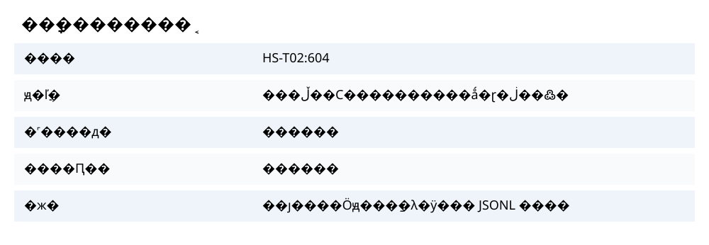
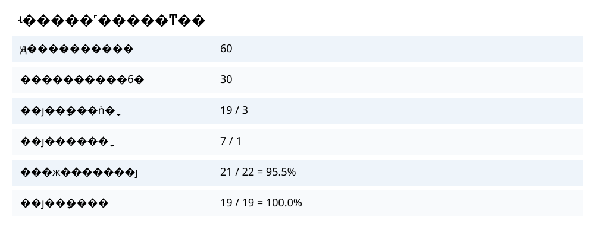
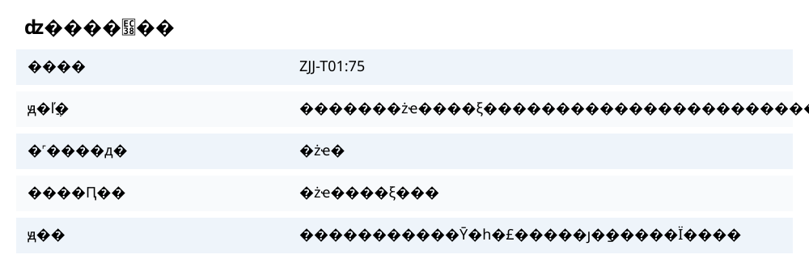
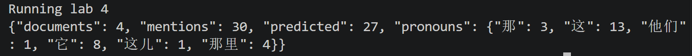

# 实验四：程序性知识的共指消解

## 4.1 代词检测与待消解样本

从实验一清洗数据中的 4 篇游客游记（HS-T01、HS-T02、JZG-T02、ZJJ-T01）抽取样本，覆盖黄山、九寨沟、张家界。以句号、问号、叹号、分号和换行为边界分句，用正则扫描“它、它们、他们、那里、这儿、那儿、这、那”。原文共扫出 **60 个字形命中**，位置与上下文全部保存在 `outputs/lab4/detection_audit.jsonl`；其中 30 个“这/那+量词”等修饰结构按当前范围排除，剩余 30 个进入待消解列表。排除项可能包含真实的指示共指，故不能把 30/60 当成召回率。每个候选由 `doc_id:pronoun_start` 唯一标识，位置为 `clean_text` 的从零开始字符偏移，结束位置不包含在内；同句重复代词不合并。来源记录号及原始分片名保存在 `outputs/lab4/candidates.jsonl`。30 个候选中 27 个有预测先行词。

## 4.2 人工标注真实先行词

`outputs/lab4/full_review.csv` 逐条审阅全部 30 个候选，包含先行词、类型、状态和判断说明；`full_evaluation.json` 给出可回查的先行词位置。标注边界以原文中最短且能独立指称的连续词组为准；集合指称、指代范围不明和后指单独列出，不强行映射到某个景点。30 例中，19 例有明确先行词、3 例非共指、7 例不确定、1 例后指。原始游记的发布网页 URL 缺失，因此保留语料记录号和 Parquet 分片作为可追溯来源，不虚构网页地址。

| ID | 代词 | 人工先行词或判定 | 规则预测 | 判断 |
|---|---|---|---|---|
| HS-T01:1059 | 那 | 莲花峰 | 莲花峰 | 正确 |
| HS-T01:1105 | 他们 | 挑夫 | 挑夫 | 正确 |
| HS-T02:444 | 它 | 飞来石 | 飞来石 | 正确 |
| HS-T02:604 | 它 | 光明顶 | 光明顶 | 正确 |
| JZG-T02:366 | 这 | 区域边界不确定 | 老虎海 | 不计分 |
| JZG-T02:1222 | 它 | “其它”中的字形，非共指 | 弃答 | 正确 |
| ZJJ-T01:75 | 那里 | 张家界 | 张家界旅游景区 | 名称粒度错误 |
| ZJJ-T01:694 | 它 | 武陵源景区 | 武陵源景区 | 正确 |

## 4.3 消解方法与实现

使用实验二 `entities.json` 中的 POI，并补充原文中以“地区、国有林场、自然风景区、旅游景区”结尾的普通地点及“路口”，人物类词单独匹配。候选窗口为代词之前 **220 个字符**；“他们”只选人物，“那里/这儿/那儿”选地点，其他代词选非人物。基础分数为负字符距离；行程动词后的地点加 45 分，比较对象减 75 分，景区总名出现在“第 X 高峰”等描述中减 65 分，地点指示表达遇普通地点加 12 分。对“甲与乙相比，但它……”优先保留比较前的主题甲；对“甲是……在……这里”优先选择被描述的甲。“其它”中的“它”及“那雅兴”按非独立共指弃答；没有合适候选也弃答。全部为可解释规则，不使用在线模型或密钥。输出保留预测实体及其原文位置。规则仍难处理事件指称、集合先行词与后指。

## 4.4 消解结果与输出

`candidates.jsonl` 保存原句、上下文、代词、预测先行词及位置，也提供替换后的句子示例。替换只作用于该代词的字符位置；原文未改写。图 4-1 展示“它→光明顶”的可追溯实例。

**图 4-1 共指消解结果例证。** 图中原文为便于展示的局部摘录，准确文本和位置以 JSONL 为准。

## 4.5 人工核验与评价

按全部 30 个候选审阅，22 例可判定（19 例明确共指、3 例非共指），其中 **21 例判断正确，准确率 21/22＝95.5%**。19 个明确共指案例均有预测，**覆盖率 19/19＝100%**。非共指样本仅在系统弃答时算正确；7 例不确定及 1 例后指不进入准确率分母。剩余错误为预测“张家界旅游景区”而人工标注“张家界”；按预定的精确字符串标准计错，不因语义相近而临时改分。这组案例用于规则设计和审阅，因此准确率只反映本样本，不能视为独立泛化成绩。图 4-2 展示统计，图 4-3 展示剩余误差。

**图 4-2 人工核验统计。** 分子、分母来自 `full_evaluation.json`，不确定与后指案例另列。

**图 4-3 剩余误差案例。** 景区名称粒度不一致；此例按精确字符串评价计错。

如图 4-4 所示，实验四入口完成 4 篇游记的检测与消解，共保留 30 个待消解候选，其中 27 个产生先行词预测。终端摘要用于证明程序实际运行；准确率和覆盖率以图 4-2 及 `full_evaluation.json` 为准。

**图 4-4 实验四运行终端截图。** 已裁去本地路径和输入命令，仅展示处理文档数、待消解候选数及预测数。

## 运行与改进

### 上游数据核查与后续使用

实验一清洗结果包含 18 条记录，其中游客游记 15 篇，`doc_id` 无重复。实验二输出 2015 个实体，逐个核对其 `start:end` 与实验一 `clean_text`，全部位置一致；没有发现清洗文本或实体偏移错位。实验五可直接使用原文，实验六应只融合有来源位置且通过核验的共指关系，不能把实验四全部自动预测当作事实。

在项目目录运行 `powershell -NoProfile -ExecutionPolicy Bypass -File .\run.ps1 -Lab 4`；入口依次生成消解结果、评价和配图。输入是 `outputs/cleaned_data.jsonl` 和 `outputs/lab2/entities.json`，结果写入 `outputs/lab4/`。若后续做独立效果验证，应另选未参与规则设计的游记并先固定标注与计分口径。
